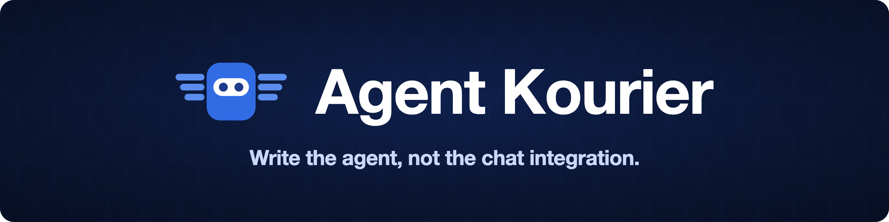
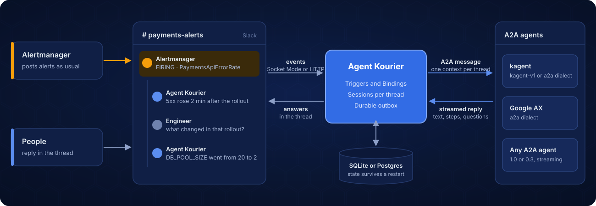

<h1 align="center">
  
</h1>

<p align="center">
  <a href="https://github.com/agentkourier/agent-kourier/releases/latest"></a>
  <a href="LICENSE"></a>
  <a href="https://github.com/agentkourier/agent-kourier/actions/workflows/ci.yml"></a>
  <a href="https://agentkourier.dev"></a>
</p>

<p align="center">A Kubernetes-native broker between Slack and streaming A2A agents (kagent or your own), one agent session per thread.</p>

You bring the agent: kagent, any streaming A2A server, or an experimental add-on for Claude Managed Agents or Google AX.
Agent Kourier runs in your cluster as the broker between your team's chat and your agents. Without a broker, every agent
that talks to Slack has to build its own Slack bot, thread-to-session tracking, streamed replies, question and approval
prompts, alert triggers, and restart recovery. With Agent Kourier, a `Binding` connects a channel to an agent, and the
agent keeps only its tools and task logic.

Slack over Socket Mode is supported. Slack HTTP mode, Microsoft Teams (`platform: teams`), signed webhooks from GitHub,
Jira Cloud, Bitbucket Cloud or Linear (`platform: webhook`), and the Claude Managed Agents and Google AX add-ons are
experimental. The `v1alpha1` resource format can change before 1.0.

[Documentation](https://agentkourier.dev) · [Demos](https://agentkourier.dev/demo/) ·
[Try it in a kind sandbox](docs/tutorials/first-agent-in-slack.md) · [Install with Helm](docs/how-to/install-with-helm.md) ·
[Recipes](examples/recipes/README.md) · [Architecture](docs/explanation/architecture.md) ·
[Release notes](docs/release-notes.md)

## What it looks like

https://github.com/user-attachments/assets/3ee659d7-1c0c-4fc5-aa61-e54d8369bf64

Watch the [116-second demo and 3-minute cross-team incident walkthrough](https://agentkourier.dev/demo/), or browse the
three-agent setup in [kourier-incident-demo](https://github.com/agentkourier/kourier-incident-demo).

A mention of Agent Kourier starts a session in a thread, and replies in that thread continue the same session without
another mention. A Binding trigger can also start a session from messages another app posts, such as an Alertmanager
alert.

An illustration of one alert thread, not captured output:

```text
#payments-alerts

Alertmanager     FIRING (1) - PaymentsApiErrorRate
  Agent Kourier  The 5xx rate rose at 14:02, two minutes after the 14:00 rollout
                 of payments-api. The new pods fail their readiness probe and
                 restart. The last crash log ends with "pool size must be >= 5".
  Engineer       what changed in that rollout?
  Agent Kourier  The ConfigMap payments-api-env changed DB_POOL_SIZE from 20 to 2.
                 Nothing else in the Deployment differs from the previous revision.
```

The answers come from your agent. The alert's thread is the agent session, people in the channel reply in it without a
mention, a repeat of the same alert attaches to the thread, and its resolve posts a note there.

## Quick start

Install the chart and its CRDs:

```sh
kubectl create namespace agent-kourier
helm install agent-kourier oci://ghcr.io/agentkourier/charts/agent-kourier --version 0.8.0 \
  -n agent-kourier
```

The pod starts and is ready with no `ChatConnection` to serve. Next, create a Secret for your Slack app and apply three
resources (a `ChatConnection`, an `AgentBackend`, and a `Binding`), or generate starter files interactively with
`docker run --rm -it --user "$(id -u):$(id -g)" -v "$PWD:/work" -w /work ghcr.io/agentkourier/agent-kourier:v0.8.0 init`.

Follow [Install with Helm](docs/how-to/install-with-helm.md) for the full walk-through, or
[Your first agent in Slack](docs/tutorials/first-agent-in-slack.md) to try Agent Kourier in a kind cluster against your
own Slack workspace.

Requirements to know up front:

- **Kubernetes 1.33 or later** for the default custom-resource route (`config.source: crds`). Earlier clusters can run
  the ConfigMap route (`config.source: files`), which needs no CRDs and no minimum Kubernetes version.
- **kagent 1.0 (`kagent-v1` dialect)** needs the Kubernetes pod-certificate APIs (`certificates.k8s.io/v1beta1`), which
  managed EKS through 1.36 cannot enable and EKS 1.37 does not serve. On those clusters, use kagent 0.9.x or another
  streaming A2A agent with the `a2a` dialect ([Connect a kagent agent](docs/how-to/connect-kagent.md)).

## What Agent Kourier handles

Without a broker, each of these is code in every agent that talks to chat:

- **Threads as sessions.** Each thread keeps one agent context for 90 days after its last
  activity by default. A reply anywhere in the thread continues it.
- **Replies during a turn.** Agent Kourier queues a reply sent while the agent works and
  sends it, in order, when the task ends. A reaction shows that it accepted the reply.
- **Streamed output.** With `output: live`, the answer streams into one chat message. In that mode tool
  calls show as step cards or status lines where the backend reports them, and a `Working…` sign of life
  shows while the agent is silent (`chat.progress`).
- **Questions and approvals.** With `interactions.askUser`, the agent's question appears in
  the thread and the answer resumes the same task. With kagent, or an agent on the `a2a` dialect
  whose card lists kagent's human-in-the-loop extension, a tool call can also wait for an Approve
  or Deny press, optionally limited to Slack user groups
  ([Connect a generic A2A agent](docs/how-to/connect-a2a-agent.md#what-works-on-this-dialect)).
- **Restart recovery.** Agent Kourier stores sessions, queued replies and pending questions,
  and posts through a durable outbox, so a crash does not repeat a post
  ([one exception](docs/explanation/delivery.md#the-one-window)).
- **Suspended agents.** Agent Kourier holds the chat connection and the thread while an
  agent is suspended or scaled down, and calls the agent when the next turn arrives.
- **Alert investigations.** A trigger reads the alerts a bot already posts to the channel
  and starts an investigation in each alert's thread, with a cooldown per alert, a rate
  limit and a daily cap. Your alerting tool sends Agent Kourier nothing. It posts to Slack, or to
  Teams through a Workflows webhook, as before, so alerts reach people whether or not
  Agent Kourier is running ([why](docs/explanation/why-a-broker.md#why-outside-the-paging-path)).
- **Reports in a channel.** A `personMessage` trigger starts a turn of the person on each message they post at the
  top level of the channel, without a mention, held to the trigger's limits. Replies under it need a mention. See
  [A person's message](docs/reference/chat-triggers.md#a-persons-message).
- **Agents that call agents.** A mention of Agent Kourier by another bot starts a turn in
  that thread, with the thread so far as untrusted data, within fixed limits. It is on by default, and a
  Binding turns it off with `chat.botMentions: none`. See
  [Let another agent start yours](docs/how-to/any-bot-trigger.md#let-another-agent-start-yours).
- **Webhooks from other services** (experimental). A webhook connection takes the
  signed JSON webhooks of a service, such as GitHub, Jira Cloud, Bitbucket Cloud or Linear, and starts a session of the agent
  for each pull request or issue. A later event of the same one, such as a comment, continues it.
  Agent Kourier posts nothing there: the agent replies on the service with its own tools. See
  [Start agents from webhooks](docs/how-to/receive-webhooks.md).
- **Feedback.** An investigation's final message has useful and not-useful buttons, and
  Prometheus counts the votes per agent and alert name.
- **Backend choice.** kagent, an agent behind an add-on, and any A2A 1.0 or 0.3 agent whose card
  advertises streaming use the same `Binding`. Changing the runtime leaves the chat
  configuration as it is.
- **Add-ons** (experimental). Optional components in this repository, released and signed under the same version and run
  by an opt-in block of the chart. The Claude Managed Agents add-on is an A2A server in front of an agent in Claude
  Managed Agents (each thread is a session, and `always_ask` tool calls wait on Approve and Deny in the thread). The AX
  add-on runs a Google AX Task from a template for each accepted turn and reports its result in the thread. See
  [Add-ons](docs/explanation/add-ons.md),
  [Connect Claude Managed Agents](docs/how-to/connect-claude-managed-agents.md) and
  [Connect the AX add-on](docs/how-to/connect-ax.md).

## Recipes

Nine worked examples live under [examples/recipes](examples/recipes/README.md) (walk-through in
[Start from a recipe](docs/how-to/recipes.md)). Each needs your own Slack or Teams app (or HTTPS webhook endpoint) and,
where a recipe ships an agent, a model key.

| Recipe | What it wires | Ships an agent? |
|---|---|---|
| [`docs-agent`](examples/recipes/docs-agent/README.md) | `@mention` in Slack to an ADK A2A agent that searches a Markdown corpus via MCP (good first recipe; runs on any cluster) | Yes |
| [`prompt-agent`](examples/recipes/prompt-agent/README.md) | `@mention` in Slack to a YAML-defined agent (prompt, model, and MCP tools) | Yes |
| [`prompt-agent-teams`](examples/recipes/prompt-agent-teams/README.md) | `@mention` and Alertmanager cards in Microsoft Teams (experimental) | Reuses `prompt-agent` |
| [`sre-triage`](examples/recipes/sre-triage/README.md) | Alertmanager Slack posts to a read-only kagent 1.0 triage agent (agent half runs on the kind full tier; Agent Kourier resources work with any agent) | Yes |
| [`custom-bot-trigger`](examples/recipes/custom-bot-trigger/README.md) | Another bot's failure posts (such as CI) via a hand-written `botMessage` trigger | No (Agent Kourier resources only) |
| [`webhook-github`](examples/recipes/webhook-github/README.md) | Signed GitHub pull-request and mention webhooks (experimental) | Yes |
| [`webhook-bitbucket`](examples/recipes/webhook-bitbucket/README.md), [`webhook-jira`](examples/recipes/webhook-jira/README.md), [`webhook-linear`](examples/recipes/webhook-linear/README.md) | Signed PR and issue webhooks where the agent replies on the service with its own tools (experimental) | No (Agent Kourier resources only) |

## For platform teams

The platform team installs Agent Kourier and owns the shared resources: the agent backends
(`AgentBackend`), the broker's own chat app (a `ChatConnection`), and the namespaces allowed
to use each. Application teams connect their own agents to their own channels with a
namespaced `Binding`, committed next to the agent's manifests.

With custom resources a team can also bring its own chat app as a `ChatConnection` in a
namespace the broker admits. The broker admits every namespace when the platform sets nothing
(for a cluster with one broker), or the namespaces on a list or whose labels match a selector.
A broker can even have no app of its own and serve only the teams'
([Let a team bring its own Slack app](docs/how-to/team-slack-app.md)).

<p align="center">
  
</p>

The custom resource install of [Install with Helm](docs/how-to/install-with-helm.md#install-on-custom-resources): a
broker with no Slack app of its own, and a team that brings its own. Recorded on a kind cluster with the
[echo agent](examples/recipes/echo-agent/agent/README.md) as the team's agent. The wait for the Binding to turn Ready,
about 25 seconds here, is cut.

- **Chat credentials you choose.** When every Binding names the broker's own
  `ChatConnection`, there is one set of chat credentials (on Slack, one app's tokens; on
  Teams, one bot's client secret) to review and rotate, not one per agent. The broker also
  serves the ChatConnections of each namespace it admits, and no others. It serves at most 16
  in all, the broker's own included, and no setting raises that.
- **One audit log.** It records each agent call and approval decision with the person's user ID
  (Slack's, or the Microsoft Entra object ID on Teams), when a person started it, and the service
  identity it ran as. A turn that a webhook event starts names no person.
- **Standard operations.** A Helm chart, Prometheus metrics, optional OpenTelemetry traces,
  and two replicas on Postgres with leader election and fencing.

## How it works

<p align="center">
  
</p>

The picture shows Slack. Each chat platform is an adapter behind one chat interface and its conformance suite, and agents
speak only A2A so a new platform needs no change to them. On Teams, the broker takes the bot's activities on the chat
listener or over a socket, reads other apps' posts (such as alerts) through Microsoft Graph, and posts through the Bot
Connector. A webhook connection sits behind the same interface, takes a service's signed events on the chat listener,
and posts nothing back: the agent answers on the service.

Commit the agent's deployment and its `Binding` together, and let GitOps deploy both.
The runtime's own manifests or operator deploy and run the agent. Agent Kourier supplies
the messaging wiring.

See the [detailed architecture](docs/explanation/architecture.md) for the
configuration, execution, persistence, and interaction paths.

## Configuration model

Three resource types describe the wiring:

| Resource | Configures | Typical owner |
|---|---|---|
| `AgentBackend` | The agent endpoint, protocol dialect, and namespaces allowed to use it | Platform team |
| `ChatConnection` | The chat platform connection, or one service's webhooks, and its Secret reference | Platform team (the broker's own); a team in a namespace the platform admits (its own app) |
| `Binding` | An agent, its service identity, and the channel connected to it | Application team |

A team adds a binding to connect an agent to a channel. Multiple bindings can share
a backend and messaging connection. Cross-namespace references require the owning
resource to allow the referring namespace.

The resources below are Kubernetes objects. The broker reads them by one of two routes:

- **Custom resources** (`config.source: crds`, the chart's default, which needs Kubernetes 1.33 or later; see
  the [chart README](charts/agent-kourier/README.md)). On Kubernetes the Helm chart installs the CRDs and the broker
  reads the resources from the cluster. There is no controller: the broker reads them with informers, and the leader
  writes each Binding's status.
- **Configuration files** (`config.source: files`), for a quick proof of concept. The chart can instead write the
  resources into a ConfigMap, as files loaded from `AGENTKOURIER_CONFIG_DIR`, which GitOps can manage with the
  Secrets and the Deployment.

The two routes are never merged. [How to move a running install](docs/how-to/migrate-config-source.md) goes from
one to the other.

For example, this configuration connects a payments agent hosted by kagent to a
Slack channel through shared infrastructure:

```yaml
apiVersion: agentkourier.dev/v1alpha1
kind: AgentBackend
metadata:
  name: kagent
  namespace: agent-kourier
spec:
  dialect: kagent-v1
  url: http://kagent-frontdoor.kagent.svc.cluster.local:4180
  allowedNamespaces: [payments]
---
apiVersion: agentkourier.dev/v1alpha1
kind: ChatConnection
metadata:
  name: slack
  namespace: agent-kourier
spec:
  platform: slack
  credentialsSecretRef:
    name: slack
  allowedNamespaces: [payments]
---
apiVersion: agentkourier.dev/v1alpha1
kind: Binding
metadata:
  name: payments-assistant
  namespace: payments
spec:
  agent:
    backendRef:
      namespace: agent-kourier
      name: kagent
    namespace: payments
    name: payments-agent
  identity:
    tokenSecretRef:
      name: payments-agent-token
      key: token
  chat:
    connectionRef:
      namespace: agent-kourier
      name: slack
    channel: C0123456789
    output: live
    threadReplies: all   # the default; "mention" ignores thread replies that do not @mention Agent Kourier
    acknowledgment: {enabled: true} # the default; the platform's own reaction (Slack: hourglass_flowing_sand); set emoji to a bare reaction name to change it
```

This example assumes the agent and authenticated backend endpoint already exist.
Replace the endpoint, agent reference, and channel ID for your deployment.

The `slack` Secret belongs in `agent-kourier` with `botToken` and `appToken` keys
(`botToken` and `signingSecret` for a connection in Slack HTTP mode). `payments-agent-token`
belongs in `payments` with a `token` key.

Each binding uses a service identity for agent calls. Individual chat users do not supply the
backend's authorization identity. This lets an alert start an investigation and several channel
members continue it under the same backend account, without each supplying a backend token.

[Create the Binding identity](docs/how-to/create-binding-identity.md) explains how to choose a user ID or obtain
and store an issued token, and why the identity must not change while sessions are open.
Agent Kourier does not create accounts or mint tokens.

To have the agent investigate the alerts a bot posts to that channel, add a
`botMessage` trigger to the Binding's `chat` block. A trigger is written in full, with its
own regexes, thread rules, limits and prompt.

[Investigate Alertmanager alerts](docs/how-to/investigate-alertmanager-alerts.md) has a
complete one for Alertmanager's Slack receiver, including the title it expects.
[Start investigations from any bot's messages](docs/how-to/any-bot-trigger.md) covers
other bots, and the [trigger reference](docs/reference/chat-triggers.md) has the fields.

## Integrations

| Kind | Integration | Status |
|---|---|---|
| Chat platform | Slack over Socket Mode: mentions, thread replies, streamed output, questions, and approvals ([Configure Slack](docs/how-to/configure-slack.md)) | Implemented |
| Chat platform | Slack over the Events API (HTTP mode), signed requests on the chat listener ([Configure Slack](docs/how-to/configure-slack.md)) | Experimental |
| Chat platform | Slack direct messages | Planned |
| Chat platform | Microsoft Teams (`http` or `socket` mode): channel mentions, Bot Connector replies/edits, Adaptive Card questions/approvals, Graph alert reading; no reactions or approver groups ([Configure Teams](docs/how-to/configure-teams.md), [Platform support](docs/reference/platforms.md), [open live checks](https://github.com/agentkourier/agent-kourier/issues/379)) | Experimental |
| Chat platform | Other platforms, through the `chat.Platform` interface and its conformance suite | Planned |
| Agent backend | kagent 1.0 (`kagent-v1` dialect): structured questions and optional Slack tool approvals. Needs pod-certificate APIs (`certificates.k8s.io/v1beta1`), which managed EKS through 1.37 does not serve ([Connect a kagent agent](docs/how-to/connect-kagent.md)) | Implemented |
| Agent backend | Any streaming A2A 1.0 or 0.3 agent over JSON-RPC (`a2a` dialect); supports kagent's human-in-the-loop extension when advertised ([Connect a generic A2A agent](docs/how-to/connect-a2a-agent.md)) | Implemented |
| Agent backend | kagent 0.9.x (`a2a` dialect over A2A 0.3): no task list, so a resend can run a turn twice ([Connect a kagent agent](docs/how-to/connect-kagent.md)) | Implemented |
| Agent backend | Claude Managed Agents add-on (`addons.cma`): session per thread, step cards, and `always_ask` tool approvals; self-hosted environments only ([Connect Claude Managed Agents](docs/how-to/connect-claude-managed-agents.md)) | Experimental |
| Agent backend | Google AX add-on (`addons.ax`): launches Google AX Tasks from a template and returns results over HTTPS ([Connect the AX add-on](docs/how-to/connect-ax.md), [add-on README](addons/ax/README.md)) | Experimental |
| Alert source | Alertmanager in Slack (`botMessage` trigger, written in full) ([Investigate Alertmanager alerts](docs/how-to/investigate-alertmanager-alerts.md)) | Implemented |
| Alert source | Alertmanager in Microsoft Teams via `msteamsv2` Workflows webhook and Microsoft Graph ([Configure Teams](docs/how-to/configure-teams.md#send-alertmanager-alerts-to-a-channel)) | Experimental |
| Alert source | Any other bot's channel messages (`botMessage` trigger) and top-level human messages (`personMessage` trigger) ([Any-bot triggers](docs/how-to/any-bot-trigger.md), [Chat triggers](docs/reference/chat-triggers.md)) | Implemented |
| Event source | Signed JSON webhooks (`platform: webhook`) from GitHub, Jira Cloud, Bitbucket Cloud, Linear or any signed sender; one session per PR or issue, agent replies on the service ([Start agents from webhooks](docs/how-to/receive-webhooks.md)) | Experimental |
| Operations | High availability: two replicas on Postgres, Kubernetes Lease leader election, and fencing ([High availability and failover](docs/explanation/high-availability.md)) | Implemented |

The common interface to an agent is streaming A2A over JSON-RPC, version 1.0 or 0.3. Agent Kourier
rejects an agent whose card does not advertise streaming. A team can change or add a runtime and
keep the same messaging configuration. What a thread can do still depends on what the backend
exposes; see [backend reference](docs/reference/agentbackend.md) for the contract.

## Release and operations

The current release is v0.8.0:

- a signed image for `linux/amd64` and `linux/arm64`, `ghcr.io/agentkourier/agent-kourier:v0.8.0`
- the Helm chart `oci://ghcr.io/agentkourier/charts/agent-kourier` version `0.8.0`, which pins that image by digest

Agent Kourier runs as one replica with a SQLite store, or as two replicas on Postgres with a
leader election and fencing, installed with the [Helm chart](charts/agent-kourier/README.md). It writes
an audit log, exports Prometheus metrics and can export OpenTelemetry traces. See
[observability](docs/reference/logs-and-traces.md), [stored data](docs/reference/stored-data.md), and
[troubleshooting](docs/how-to/troubleshoot.md).

### High availability

On Postgres, Agent Kourier runs as two replicas, active/passive. With SQLite it is one
replica, and the chart refuses more.

The leader does all the work. The standby serves health and metrics, opens no chat
connection, and takes over about 15 s after the leader's last renewal, with the same
recovery as a restart. Every write to Postgres and to the chat platform is fenced, so a
deposed leader's writes are refused.

[High availability and failover](docs/explanation/high-availability.md) explains how it
works and what a failover can still repeat.
[Run two replicas](docs/how-to/high-availability.md) sets it up and drills a failover.

## Development

Use the Go version declared in [go.mod](go.mod). Build and check the project with:

```sh
make fmt lint test build
```

The build produces `bin/agent-kourier`. Kubernetes test environments and the real-Slack
sandbox are available through the Makefile. Run `make` to list the targets, and see
[CONTRIBUTING.md](CONTRIBUTING.md) for contributor checks and conventions.

## License

Apache License 2.0. See [LICENSE](LICENSE).
