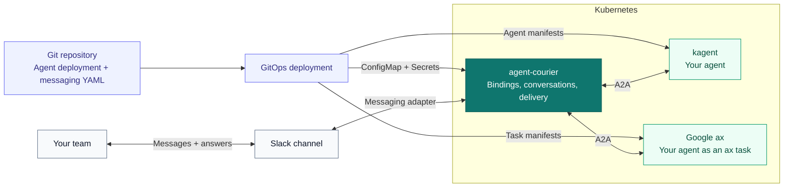

# agent-courier

Declare the messaging connections for your Kubernetes agents as infrastructure as code.

agent-courier connects agents to Slack through declarative configuration. Teams can
deploy an agent with their chosen runtime and keep its messaging wiring alongside
their deployment manifests in Git. Courier handles conversations, queued replies,
streamed output, and human interactions through a shared broker.

The goal is to make deploying a conversational agent as straightforward as deploying
its runtime and declaring which channel should reach it. Platform teams operate the
broker and shared connections; application teams configure their agents' bindings.

## How it works

Commit the agent deployment and its messaging binding together. GitOps deploys the
runtime and Courier configuration; people reach the agent through their channel.



Both kagent and ax are supported backends. Runtime deployment belongs to the
runtime's manifests or operator. Courier supplies the messaging wiring. See the
[detailed architecture](docs/architecture.md) for the configuration, execution,
persistence, and interaction paths.

## Configuration model

Three resource types describe the wiring:

| Resource | Configures | Typical owner |
|---|---|---|
| `AgentBackend` | The agent endpoint, protocol dialect, and namespaces allowed to use it | Platform team |
| `ChatConnection` | The messaging connection and its Secret references | Platform team |
| `Binding` | An agent, its service identity, and the channel connected to it | Application team |

A team adds a binding to connect an agent to a channel. Multiple bindings can share
a backend and messaging connection. Cross-namespace references require the owning
resource to allow the referring namespace.

For example, this configuration connects a payments agent hosted by kagent to a
Slack channel through shared infrastructure:

```yaml
apiVersion: agentcourier.dev/v1alpha1
kind: AgentBackend
metadata:
  name: kagent
  namespace: courier-system
spec:
  dialect: kagent-v1
  url: http://kagent-frontdoor.kagent.svc.cluster.local:4180
  allowedNamespaces: [payments]
---
apiVersion: agentcourier.dev/v1alpha1
kind: ChatConnection
metadata:
  name: slack
  namespace: courier-system
spec:
  platform: slack
  mode: socket
  credentialsSecretRef:
    name: courier-slack
  allowedNamespaces: [payments]
---
apiVersion: agentcourier.dev/v1alpha1
kind: Binding
metadata:
  name: payments-assistant
  namespace: payments
spec:
  agent:
    backendRef:
      namespace: courier-system
      name: kagent
    namespace: payments
    name: payments-agent
  identity:
    tokenSecretRef:
      name: payments-agent-token
      key: token
  chat:
    connectionRef:
      namespace: courier-system
      name: slack
    channel: C0123456789
    output: live
```

This example assumes the agent and authenticated backend endpoint already exist.
Replace the endpoint, agent reference, and channel ID for your deployment. The
`courier-slack` Secret belongs in `courier-system` with `botToken` and `appToken`
keys; `payments-agent-token` belongs in `payments` with a `token` key. Each binding
uses a service identity for agent calls; individual Slack users do not supply the
backend's authorization identity.

In the current pilot, these are **configuration files**, loaded from
`COURIER_CONFIG_DIR`, usually through a mounted ConfigMap. They are not yet live
custom resources reconciled by a Courier controller. GitOps can manage the
ConfigMap, Secrets, and Deployment; CRD/controller reconciliation is planned.

## Pluggable agent runtimes

Runtime choice is part of the design. Courier supplies the messaging integration;
the selected runtime manages agent deployment and execution. The current common
interface is A2A 1.0 over JSON-RPC, with dialects for backend-specific behavior.

| Backend | Current integration |
|---|---|
| kagent 1.0 | `kagent-v1` dialect, including structured questions and approval interactions |
| Other A2A 1.0 agents | `a2a` dialect, with text-based continuation when no structured interaction extension is recognized |
| Google ax | Supported: `a2a` dialect through ax's `atenet-router`, selecting the agent with an `ate-target-actor` header. Tested in `make e2e-ax`. Structured tool approvals and tool step cards are kagent-only |

ax speaks A2A, so it needs no separate dialect. This `AgentBackend` reaches an
agent running as an ax task; the header names the namespace and actor, and the
agent card is served at the URL plus `/.well-known/agent-card.json`:

```yaml
apiVersion: agentcourier.dev/v1alpha1
kind: AgentBackend
metadata:
  name: ax
  namespace: courier-system
spec:
  dialect: a2a
  url: http://atenet-router.ate-system.svc.cluster.local/a2a
  headers:
    - name: ate-target-actor
      value: courier-ax/assistant
```

The intent is to let teams change or add agent runtimes while keeping the same
messaging configuration model. Interaction capabilities still depend on what the
backend exposes. See [backend design](spec.md#63-backends) for the current contract
and ax boundaries.

## Current scope

The implemented chat path includes Slack Socket Mode, mentions, thread replies,
direct messages, streamed output, durable reply queues, restart recovery, and
human questions. Courier also provides audit logging, Prometheus metrics, and
optional OpenTelemetry tracing. See [observability](docs/observability.md).

Slack is the implemented messaging adapter. Additional messaging platforms are
planned through the chat adapter interface. Alert investigation is one application
of the wiring model: automatic chat triggers and direct Alertmanager ingress are
planned, rather than prerequisites for using Courier with an agent.

The project is in an internal-first pilot. Start with the
[sandbox deployment guide](hack/kind/sandbox/README.md) for the existing kagent and
real-Slack setup. The [specification](spec.md) records the detailed behavior, and
the [implementation plan](tasks/plans/agent-courier-pilot.md) tracks delivery.

## Try it with AX

[`examples/ax`](examples/ax/README.md) is an ADK agent on Bedrock Haiku that runs as
an ax task, with a sample `AgentBackend` and `Binding`. It is experimental. The AX
kind tier (`make e2e-ax-up`, `make e2e-ax`) runs the shared Slack scenarios against
a real ax and Substrate install with a deterministic model, so it costs no tokens;
see [its guide](hack/kind/ax/README.md) for the scenario table.

## Development

Use the Go version declared in [go.mod](go.mod). Build and check the project with:

```sh
make fmt lint test build
```

The build produces `bin/courier`. Kubernetes test environments and the real-Slack
sandbox are available through the Makefile; run `make` to list the targets.
