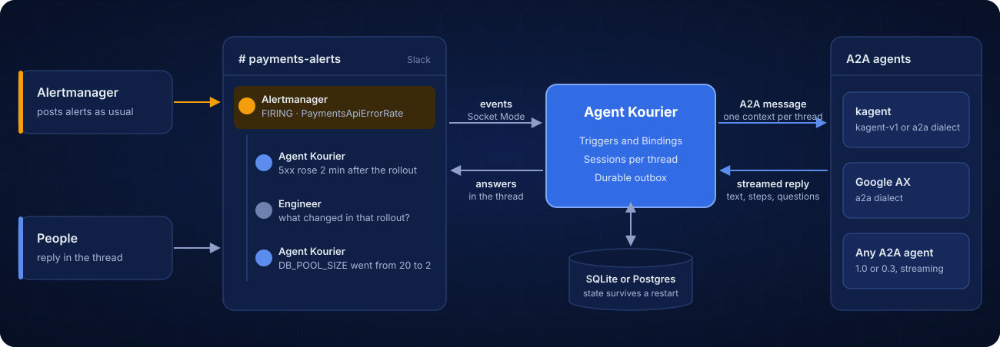

<h1 align="center">
  
</h1>

<p align="center">A Kubernetes-native broker between team chat and streaming A2A agents. Slack today; more platforms planned.</p>

Agent Kourier runs in your cluster between your team's chat and your agents. A `Binding`
connects a channel to an agent that serves streaming A2A, and Agent Kourier handles the
chat side: a session per thread, streamed replies, questions to people, investigations
started by alerts, and recovery after a restart or failover. The agent needs no chat code.
It keeps its tools and task logic.

Slack is the supported platform today. Each platform is an adapter behind one chat
interface and its conformance suite, and the resource API takes a second platform without
breaking a Slack `Binding`. Agents speak only A2A, so a new platform needs no change to them.

[Documentation](https://agentkourier.dev) · [Try it in a kind sandbox](docs/tutorials/first-agent-in-slack.md) ·
[Install with Helm](docs/how-to/install-with-helm.md) · [Architecture](docs/explanation/architecture.md)

> **Status: v0.1.5.** Install the published chart and image with
> [Install with Helm](docs/how-to/install-with-helm.md). The `v1alpha1` resource format can change before 1.0. See
> [Status](#status).

## What it looks like

https://github.com/user-attachments/assets/1af66d63-78cd-437d-a3a2-2e178904d177

An illustration of one alert thread, not captured output:

```text
#payments-alerts

Alertmanager     FIRING (1) - PaymentsApiErrorRate
  Agent Kourier  The 5xx rate rose at 14:02, two minutes after the 14:00 rollout
                 of payments-api. The new pods fail their readiness probe and
                 restart. The last crash log ends with "pool size must be >= 5".
  Engineer       what changed in that rollout?
  Agent Kourier  The ConfigMap payments-api-env changed DB_POOL_SIZE from 20 to 2.
                 Nothing else in the Deployment differs from the previous revision.
```

The answers come from the agent. The alert's thread is the agent session. People in the
channel reply in it without a mention. A repeat of the same alert attaches to the thread,
and its resolve posts a note there.

## What Agent Kourier handles

Without a broker, each of these is code in every agent that talks to chat:

- **Threads as sessions.** Each thread keeps one agent context for 90 days after its last
  activity by default. A reply anywhere in the thread continues it.
- **Replies during a turn.** Agent Kourier queues a reply sent while the agent works and
  sends it, in order, when the task ends. A reaction shows that it accepted the reply.
- **Streamed output.** With `output: live`, the answer streams into one chat message, with
  tool calls shown as step cards or status lines where the backend reports them, and a `Working…` sign of life while the agent is
  silent (`chat.progress`).
- **Questions and approvals.** With `interactions.askUser`, the agent's question appears in
  the thread and the answer resumes the same task. With kagent, or an agent on the `a2a` dialect
  whose card lists kagent's human-in-the-loop extension, a tool call can wait for an Approve or
  Deny press, optionally limited to Slack user groups
  ([Connect a generic A2A agent](docs/how-to/connect-a2a-agent.md#what-works-on-this-dialect)).
- **Restart recovery.** Agent Kourier stores sessions, queued replies and pending questions,
  and posts through a durable outbox, so a crash does not repeat a post
  ([one exception](docs/explanation/delivery.md#the-one-window)).
- **Suspended agents.** Agent Kourier holds the Slack connection and the thread while an
  agent is suspended or scaled down, and calls the agent when the next turn arrives.
- **Alert investigations.** A trigger reads the alerts a bot already posts to the channel
  and starts an investigation in each alert's thread, with a cooldown per alert, a rate
  limit and a daily cap. There is no webhook, so alerts reach people whether or not Agent
  Kourier is running.
- **Feedback.** An investigation's final message has useful and not-useful buttons, and
  Prometheus counts the votes per agent and alert name.
- **Backend choice.** kagent, an agent in Google AX, and any A2A 1.0 or 0.3 agent whose card
  advertises streaming use the same `Binding`. Changing the runtime leaves the Slack
  configuration as it is.

## For platform teams

The platform team installs Agent Kourier and owns the shared resources: the chat app (a
`ChatConnection`), the agent backends (`AgentBackend`), and the namespaces allowed to use
each. Application teams connect their own agents to their own channels with a namespaced
`Binding`, committed next to the agent's manifests.

- **One chat app.** Every Binding that uses a `ChatConnection` posts through it, so there is
  one set of chat credentials (on Slack, one app's tokens) to review and rotate, not one per
  agent.
- **One audit log.** It records each agent call and approval decision with the Slack user,
  when a person started it, and the service identity it ran as.
- **Standard operations.** A Helm chart, Prometheus metrics, optional OpenTelemetry traces,
  and two replicas on Postgres with leader election and fencing.

## How it works

<p align="center">
  
</p>

Commit the agent's deployment and its `Binding` together, and let GitOps deploy both.
The runtime's own manifests or operator deploy and run the agent. Agent Kourier supplies
the messaging wiring. See the [detailed architecture](docs/explanation/architecture.md) for the
configuration, execution, persistence, and interaction paths.

## Configuration model

Three resource types describe the wiring:

| Resource | Configures | Typical owner |
|---|---|---|
| `AgentBackend` | The agent endpoint, protocol dialect, and namespaces allowed to use it | Platform team |
| `ChatConnection` | The messaging connection and its Secret references | Platform team |
| `Binding` | An agent, its service identity, and the channel connected to it | Application team |

A team adds a binding to connect an agent to a channel. Multiple bindings can share
a backend and messaging connection. Cross-namespace references require the owning
resource to allow the referring namespace.

The resources below look like Kubernetes objects, but they are **configuration files**, loaded from
`AGENTKOURIER_CONFIG_DIR`, usually through a mounted ConfigMap. They are not yet live
custom resources reconciled by an Agent Kourier controller. GitOps can manage the
ConfigMap, Secrets, and Deployment; CRD/controller reconciliation is planned.

For example, this configuration connects a payments agent hosted by kagent to a
Slack channel through shared infrastructure:

```yaml
apiVersion: agentkourier.dev/v1alpha1
kind: AgentBackend
metadata:
  name: kagent
  namespace: agent-kourier
spec:
  dialect: kagent-v1
  url: http://kagent-frontdoor.kagent.svc.cluster.local:4180
  allowedNamespaces: [payments]
---
apiVersion: agentkourier.dev/v1alpha1
kind: ChatConnection
metadata:
  name: slack
  namespace: agent-kourier
spec:
  platform: slack
  credentialsSecretRef:
    name: agent-kourier-slack
  allowedNamespaces: [payments]
---
apiVersion: agentkourier.dev/v1alpha1
kind: Binding
metadata:
  name: payments-assistant
  namespace: payments
spec:
  agent:
    backendRef:
      namespace: agent-kourier
      name: kagent
    namespace: payments
    name: payments-agent
  identity:
    tokenSecretRef:
      name: payments-agent-token
      key: token
  chat:
    connectionRef:
      namespace: agent-kourier
      name: slack
    channel: C0123456789
    output: live
    threadReplies: all   # the default; "mention" ignores thread replies that do not @mention Agent Kourier
    acknowledgment: {enabled: true} # the default; the platform's own reaction (Slack: hourglass_flowing_sand); set emoji to a bare reaction name to change it
```

This example assumes the agent and authenticated backend endpoint already exist.
Replace the endpoint, agent reference, and channel ID for your deployment. The
`agent-kourier-slack` Secret belongs in `agent-kourier` with `botToken` and `appToken`
keys; `payments-agent-token` belongs in `payments` with a `token` key. Each binding
uses a service identity for agent calls; individual Slack users do not supply the
backend's authorization identity.

This lets an alert start an investigation and several channel members continue it
under the same backend account, without each supplying a backend token.
[Create the Binding identity](docs/how-to/create-binding-identity.md) explains how to choose a user ID or obtain
and store an issued token, and why the identity must not change while sessions are open.
Agent Kourier does not create accounts or mint tokens.

To have the agent investigate the alerts a bot posts to that channel, add a
`botMessage` trigger to the Binding's `chat` block. A trigger is written in full, with its
own regexes, thread rules, limits and prompt.
[Investigate Alertmanager alerts](docs/how-to/investigate-alertmanager-alerts.md) has a
complete one for Alertmanager's Slack receiver, including the title it expects;
[Start investigations from any bot's messages](docs/how-to/any-bot-trigger.md) covers
other bots, and the [trigger reference](docs/reference/chat-triggers.md) has the fields.

## Integrations

| Kind | Integration | Status |
|---|---|---|
| Chat platform | Slack over Socket Mode: mentions, thread replies, streamed output, questions | Implemented |
| Chat platform | Slack over the Events API (HTTP) | Planned |
| Chat platform | Slack direct messages | Planned |
| Chat platform | Other platforms, through the `chat.Platform` interface and its conformance suite | Planned |
| Agent backend | kagent 1.0, `kagent-v1` dialect, with structured questions and optional Slack tool approvals. Tested against 1.0.0-alpha5. Needs a cluster that serves the pod-certificate APIs, which managed EKS through 1.36 cannot; see [Connect a kagent agent](docs/how-to/connect-kagent.md) | Implemented |
| Agent backend | Any A2A agent, 1.0 or 0.3, whose card advertises streaming and a JSON-RPC interface, `a2a` dialect. Questions arrive as text, or as kagent's structured questions and tool approvals when the card lists its human-in-the-loop extension | Implemented |
| Agent backend | kagent 0.9.x, `a2a` dialect over A2A 0.3. Tested against 0.9.4 on a real cluster. It has no task list, so a resend can run a turn twice, and the dialect shows its tool calls as step cards. See [Connect a kagent agent](docs/how-to/connect-kagent.md) | Implemented |
| Agent backend | Google AX, through an ADK agent in an AX Task and the `a2a` dialect. See [examples/ax](examples/ax/README.md) | Experimental |
| Alert source | Alertmanager, through the message it posts to Slack (`botMessage` trigger, written in full) | Implemented |
| Alert source | Any other bot that posts to the channel, with a `botMessage` trigger written in full; not exercised in the sandbox or the end-to-end tests | Implemented |
| Operations | High availability: two replicas on Postgres, one leader elected by a Kubernetes Lease, fencing, and a standby that takes over. See [High availability and failover](docs/explanation/high-availability.md) | Implemented |

The common interface to an agent is streaming A2A over JSON-RPC, version 1.0 or 0.3, and Agent Kourier
rejects an agent whose card does not advertise streaming. A team can change or add
a runtime and keep the same messaging configuration. What a thread can do still
depends on what the backend exposes. See [backend reference](docs/reference/agentbackend.md) for
the contract.

## Status

The current release is v0.1.5: a signed image for `linux/amd64` and `linux/arm64`,
`ghcr.io/agentkourier/agent-kourier:v0.1.5`, and the Helm chart `oci://ghcr.io/agentkourier/charts/agent-kourier`
version `0.1.5`, which pins that image by digest. It runs as one
replica with a SQLite store, or as two replicas on Postgres with a leader election
and fencing, installed with the [Helm chart](charts/agent-kourier/README.md). Agent Kourier writes
an audit log, exports Prometheus metrics and can export OpenTelemetry traces. See
[observability](docs/reference/logs-and-traces.md), and [stored data](docs/reference/stored-data.md) for what
Agent Kourier keeps and for how long.

To try it first, follow [Your first agent in Slack](docs/tutorials/first-agent-in-slack.md), which runs
Agent Kourier against a real Slack workspace and a kagent agent in kind. To run it on a
cluster, follow [Install with Helm](docs/how-to/install-with-helm.md), and see
[troubleshooting](docs/how-to/troubleshoot.md) when a first install does not answer.

### High availability

On Postgres, Agent Kourier runs as two replicas, active/passive. With SQLite it is one
replica, and the chart refuses more. The leader does all the work; the standby serves
health and metrics, opens no Slack connection, and takes over about 15 s after the
leader's last renewal, with the same recovery as a restart. Every write to Postgres and
to Slack is fenced, so a deposed leader's writes are refused.
[High availability and failover](docs/explanation/high-availability.md) explains how it
works and what a failover can still repeat;
[Run two replicas](docs/how-to/high-availability.md) sets it up and drills a failover.

## Using Google AX

Agent Kourier speaks A2A to an agent you run inside an AX Task, through AX's router, with
the generic `a2a` dialect; it does not call AX's own API or manage the Task.
[Connect an agent on Google AX](docs/how-to/connect-ax.md) lists what that needs (your
own A2A agent, token verification, a TLS gateway) and what a thread can do there, and the
[AX example](examples/ax/README.md) is a reference agent with deployment steps and an
acceptance procedure. Support is experimental.

## Development

Use the Go version declared in [go.mod](go.mod). Build and check the project with:

```sh
make fmt lint test build
```

The build produces `bin/agent-kourier`. Kubernetes test environments and the real-Slack
sandbox are available through the Makefile; run `make` to list the targets.

A race build of the whole module puts several gigabytes in the Go build cache for each
worktree, because package paths are part of the cache key. A checkout per
worktree fills a disk. Check `df -h` before a long run, and run `go clean -cache` after merging.

## License

Apache License 2.0. See [LICENSE](LICENSE).
