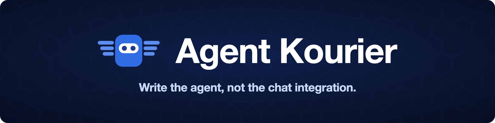
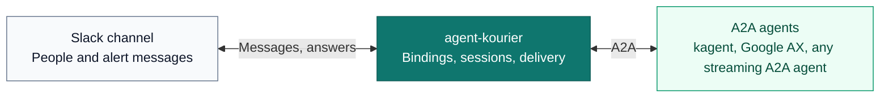

<h1 align="center">
  
</h1>

<p align="center"><strong>Declarative chat gateway for Kubernetes agents.</strong></p>

Agent Kourier is a Kubernetes-native broker that carries alerts and Slack messages to
any A2A agent, wakes it if needed, and brings its findings back into the Slack thread
where people can keep the session going. A team commits a `Binding` next to its
agent's manifests, and the agent answers mentions, follows up in threads, and
investigates the alerts a bot already posts to the channel. The broker holds the Slack
connection, the reply queue and the delivery state, so an Agent Kourier restart loses
no message.

[Documentation](https://agentkourier.dev) · [Try it in a kind sandbox](hack/kind/sandbox/README.md) ·
[Architecture](docs/explanation/architecture.md) · [Roadmap](ROADMAP.md) ·
[Specification](spec.md)

## What it looks like

https://github.com/user-attachments/assets/d503caad-4341-4824-982a-700ea6a0897f

An illustration of one alert thread, not captured output:

```text
#payments-alerts

Alertmanager     FIRING (1) - PaymentsApiErrorRate
  Agent Kourier  The 5xx rate rose at 14:02, two minutes after the 14:00 rollout
                 of payments-api. The new pods fail their readiness probe and
                 restart. The last crash log ends with "pool size must be >= 5".
  Engineer       what changed in that rollout?
  Agent Kourier  The ConfigMap payments-api-env changed DB_POOL_SIZE from 20 to 2.
                 Nothing else in the Deployment differs from the previous revision.
```

The alert's thread is the agent session. People in the channel reply in it without
a mention. A repeat of the same alert attaches to the thread, and its resolve posts
a note there.

## Why a broker

- **Conversations survive a restart.** Agent Kourier persists sessions, queued replies and
  pending questions. After a restart it continues each conversation where it stopped.
- **A crash does not repeat a post.** Posts go through a durable outbox. After a
  crash between posting and recording, Agent Kourier finds the message it already posted
  and does not post it again. A streamed reply is the exception: if Agent Kourier dies
  between starting a stream and recording it, the partial stream stays and the
  recovered turn posts the whole answer as a new message.
- **Questions are answered in the thread.** With `interactions.askUser` set on the
  `Binding`, Agent Kourier renders the agent's question in the thread and resumes the same
  agent task with the answer.
- **Alerts become conversations.** A `botMessage` trigger reads the alerts a bot
  posts to the channel, named by its bot ID, and starts an investigation in each
  alert's thread, with a cooldown per alert, a rate limit and a daily cap. A preset
  fills it in for Alertmanager; another bot's trigger is written in full. Agent
  Kourier reads what is already posted, so it is never in the paging path.
- **Any streaming A2A backend.** A kagent agent, an agent running in Google AX and any
  other A2A 1.0 or 0.3 agent whose card advertises streaming use the same `Binding`.
  Backend-specific behaviour lives in a dialect.
- **Teams own their bindings.** A `Binding` is namespaced. The platform team runs the
  broker and the shared Slack connection. An application team wires its own channel
  to its own agent.

## How it works



Commit the agent's deployment and its `Binding` together, and let GitOps deploy both.
The runtime's own manifests or operator deploy and run the agent. Agent Kourier supplies
the messaging wiring. See the [detailed architecture](docs/explanation/architecture.md) for the
configuration, execution, persistence, and interaction paths.

## Configuration model

Three resource types describe the wiring:

| Resource | Configures | Typical owner |
|---|---|---|
| `AgentBackend` | The agent endpoint, protocol dialect, and namespaces allowed to use it | Platform team |
| `ChatConnection` | The messaging connection and its Secret references | Platform team |
| `Binding` | An agent, its service identity, and the channel connected to it | Application team |

A team adds a binding to connect an agent to a channel. Multiple bindings can share
a backend and messaging connection. Cross-namespace references require the owning
resource to allow the referring namespace.

For example, this configuration connects a payments agent hosted by kagent to a
Slack channel through shared infrastructure:

```yaml
apiVersion: agentkourier.dev/v1alpha1
kind: AgentBackend
metadata:
  name: kagent
  namespace: agent-kourier-system
spec:
  dialect: kagent-v1
  url: http://kagent-frontdoor.kagent.svc.cluster.local:4180
  allowedNamespaces: [payments]
---
apiVersion: agentkourier.dev/v1alpha1
kind: ChatConnection
metadata:
  name: slack
  namespace: agent-kourier-system
spec:
  platform: slack
  mode: socket
  credentialsSecretRef:
    name: agent-kourier-slack
  allowedNamespaces: [payments]
---
apiVersion: agentkourier.dev/v1alpha1
kind: Binding
metadata:
  name: payments-assistant
  namespace: payments
spec:
  agent:
    backendRef:
      namespace: agent-kourier-system
      name: kagent
    namespace: payments
    name: payments-agent
  identity:
    tokenSecretRef:
      name: payments-agent-token
      key: token
  chat:
    connectionRef:
      namespace: agent-kourier-system
      name: slack
    channel: C0123456789
    output: live
    threadReplies: all   # the default; "mention" ignores thread replies that do not @mention Agent Kourier
```

This example assumes the agent and authenticated backend endpoint already exist.
Replace the endpoint, agent reference, and channel ID for your deployment. The
`agent-kourier-slack` Secret belongs in `agent-kourier-system` with `botToken` and `appToken`
keys; `payments-agent-token` belongs in `payments` with a `token` key. Each binding
uses a service identity for agent calls; individual Slack users do not supply the
backend's authorization identity.

To have the agent investigate the alerts a bot posts to that channel, list the
triggers in the Binding's `chat` block. The example below is for Alertmanager, the one
alert source with a preset; for another bot, write the trigger's `match`, `extract`
and prompt template yourself, as
[Start investigations from any bot's messages](docs/how-to/any-bot-trigger.md) shows. `botId`
is the `bot_id` carried by the alert
messages themselves, which starts with `B`. It is not the Slack app ID, which starts
with `A`, and Agent Kourier rejects a name. The dry run in the
[sandbox guide](hack/kind/sandbox/README.md) prints each message's sender, which is
one way to read it. The `alertmanager` preset supplies the matching, the thread
rules, the limits and the prompt, and the [trigger reference](spec.md#82-chat) has
the fields a Binding can override.

```yaml
  chat:
    connectionRef:
      namespace: agent-kourier-system
      name: slack
    channel: C0123456789
    output: live
    triggers:
      - type: mention
      - type: botMessage
        from:
          botId: B0123456789
        preset: alertmanager
```

The preset matches one message shape, and a message of another shape starts no
investigation. It needs a title that reads `FIRING (1) - <alertname>` or
`RESOLVED - <alertname>`, and Alertmanager's default fallback text, which begins
`[FIRING:1]`. Alertmanager's default Slack title begins `[FIRING:1]` too, so a
receiver that keeps the default title does not match. Either set the receiver's
title to the shape above, or override the preset's `match` and `extract` entries for
your own template.

In the current pilot, these are **configuration files**, loaded from
`AGENTKOURIER_CONFIG_DIR`, usually through a mounted ConfigMap. They are not yet live
custom resources reconciled by an Agent Kourier controller. GitOps can manage the
ConfigMap, Secrets, and Deployment; CRD/controller reconciliation is planned.

## Integrations

| Kind | Integration | Status |
|---|---|---|
| Chat platform | Slack over Socket Mode: mentions, thread replies, streamed output, questions | Implemented |
| Chat platform | Slack over the Events API (HTTP) | Planned |
| Chat platform | Slack direct messages | Planned |
| Chat platform | Other platforms, through the `chat.Platform` interface and its conformance suite | Planned |
| Agent backend | kagent 1.0, `kagent-v1` dialect, with structured questions. Tested against 1.0.0-alpha5. Agent Kourier refuses a tool approval request and posts a notice. Needs a cluster that serves the pod-certificate APIs (see below) | Implemented |
| Agent backend | Any A2A agent, 1.0 or 0.3, whose card advertises streaming and a JSON-RPC interface, `a2a` dialect. Questions arrive as text | Implemented |
| Agent backend | kagent 0.9.x, `a2a` dialect over A2A 0.3. Tested against 0.9.4 on a real cluster. It has no task list, so a resend can run a turn twice, and the dialect renders no tool calls as step cards. See [Connect a kagent agent](docs/how-to/connect-kagent.md) | Implemented |
| Agent backend | Google AX, through an ADK agent in an AX Task and the `a2a` dialect. See [examples/ax](examples/ax/README.md) | Experimental |
| Agent backend | Tool approvals answered from Slack | Planned |
| Alert source | Alertmanager, through the message it posts to Slack (`botMessage` trigger, `alertmanager` preset) | Implemented |
| Alert source | Any other bot that posts to the channel, with a `botMessage` trigger written in full; no preset, and not exercised in the sandbox or the end-to-end tests | Implemented |
| Alert source | Alertmanager webhook, received by Agent Kourier directly | Planned |
| Operations | High availability: two replicas on Postgres, one leader elected by a Kubernetes Lease, epoch fencing in Postgres and chat writes fenced on the replica, a standby that takes over. The failover test (S16: kill the leader mid-turn, mid-post and mid-storm, freeze it past its Lease) checks that every reply appears once; a call already in flight in a frozen leader can still repeat | Implemented |

The common interface to an agent is streaming A2A over JSON-RPC, version 1.0 or 0.3, and Agent Kourier
rejects an agent whose card does not advertise streaming. A team can change or add
a runtime and keep the same messaging configuration. What a thread can do still
depends on what the backend exposes. See [backend design](spec.md#63-backends) for
the contract.

### Running kagent 1.0 off kind

kagent 1.0 runs every agent session on Agent Substrate, and Substrate needs the
pod-certificate APIs: the `ClusterTrustBundle`, `ClusterTrustBundleProjection` and
`PodCertificateRequest` feature gates and `certificates.k8s.io/v1beta1`. They are off by
default through Kubernetes 1.36, and the pinned Substrate (0.3.0-alpha1) still needs
`certificates.k8s.io/v1beta1` on 1.37. Managed EKS cannot enable them. The kind tiers
turn them on, so a cluster that kind runs fine may still not run kagent 1.0. Check the
target cluster first:

```sh
kubectl api-resources --api-group=certificates.k8s.io   # lists clustertrustbundles and podcertificaterequests
kubectl api-versions | grep certificates.k8s.io/v1beta1
```

Without them, use an agent that does not need Substrate, through the `a2a` dialect.
kagent 0.9.x is one. It speaks A2A 0.3, which the dialect reads. See
[Connect a kagent agent](docs/how-to/connect-kagent.md) for the URL form and the
limits, and [risk R19](spec.md#14-risks) for why.

## Status

The project is in an internal-first pilot and has no tagged release. It runs as one
replica with a SQLite store, or as two replicas on Postgres with a leader election
and fencing, installed with the [Helm chart](charts/agent-kourier/README.md). Agent Kourier writes
an audit log, exports Prometheus metrics and can export OpenTelemetry traces. See
[observability](docs/reference/logs-and-traces.md), and [stored data](docs/reference/stored-data.md) for what
Agent Kourier keeps and for how long.

To try it first, use the [sandbox deployment guide](hack/kind/sandbox/README.md), which runs
Agent Kourier against a real Slack workspace and a kagent agent in kind. To run it on a
cluster, follow [Install with Helm](docs/how-to/install-with-helm.md), and see
[troubleshooting](docs/how-to/troubleshoot.md) when a first install does not answer. The
[specification](spec.md) records the detailed behaviour, and the
[roadmap](ROADMAP.md) lists what comes next.

### High availability

On Postgres, Agent Kourier runs as two replicas, active/passive. With SQLite it is one
replica, and the chart refuses more.

| Part | What it does |
|---|---|
| Leader election | A Kubernetes Lease picks the leader, which does all the work: Socket Mode, turns, the outbox, sweeps. A standby takes the Lease about 15 s after the leader's last renewal (a lease duration), or seconds after the leader stops on a signal and hands it over |
| Fencing | Every write to Postgres checks the leader's epoch, and every write to Slack checks the replica's own Lease clock, so a deposed or paused leader's writes are refused and it exits |
| Standby | Ready, serving health and metrics, with its config and Secret caches warm; it does no work and opens no Slack connection |
| Takeover | The same recovery as a restart: queued turns resume, the outbox adopts what was already posted, and a stream the old leader left open is replaced with the whole answer |
| Drains and spreading | A PodDisruptionBudget (`minAvailable: 1`) keeps a drain from taking both replicas, and the render refuses a budget that would block every drain. Anti-affinity, `priorityClassName`, `nodeSelector` and `tolerations` go in the chart's values; the chart sets no spread of its own |

See [High availability and failover](docs/explanation/high-availability.md) for how it
works and what a failover can still repeat, and
[Run two replicas](docs/how-to/high-availability.md) to set it up and drill a failover.

## Using Google AX

Agent Kourier does not call AX's own API. It speaks A2A to an agent that runs inside an AX
Task, through AX's router, with the generic `a2a` dialect. What that needs:

- **Your own A2A agent.** AX ships no A2A agent, so you build and run one as an AX
  Task. [`examples/ax`](examples/ax/README.md) is the reference: an ADK agent on
  Bedrock Haiku.
- **The agent verifies Agent Kourier's token.** Agent Kourier sends the Binding's service ID
  token as a bearer token. With kagent the front door checks it; with AX nothing
  does unless your agent does (the reference checks issuer, audience and subject),
  or you put an OIDC-verifying proxy in front of the router.
- **A TLS gateway in front of the router** that forwards only the A2A endpoint and
  card and fixes the actor header, reachable from Agent Kourier only.
- **Questions are plain text.** The agent's question appears in the thread and a
  person answers by replying there. Structured tool approvals and tool step cards
  are kagent-only.
- **AX's lifecycle stays with the operator.** Agent Kourier creates, pauses or resumes no
  task.

The `AgentBackend` points at the gateway, and the header names the actor
(`<atespace>/<actor>`). Agent Kourier fetches the agent's card at the URL plus
`/.well-known/agent-card.json`:

```yaml
apiVersion: agentkourier.dev/v1alpha1
kind: AgentBackend
metadata:
  name: ax
  namespace: agent-kourier-system
spec:
  dialect: a2a
  url: https://ax-gateway.example.internal/a2a # the exact JSON-RPC endpoint, used as written: a trailing
                                               # slash is kept, and no redirect is followed (kagent 0.9.x
                                               # answers a POST without its slash with a 307)
  headers:
    - name: ate-target-actor
      value: agent-kourier-ax/assistant
```

The [AX example guide](examples/ax/README.md) has the deployment steps (the gateway,
egress and credential injection, the template overlay) and an acceptance procedure
to run before a real channel. The AX kind tier (`make e2e-ax-up`, `make e2e-ax`)
runs the shared Slack scenarios against a real AX and Substrate install with a
deterministic model; see [its guide](hack/kind/ax/README.md). Support is
experimental: a real AX deployment's pause and resume is covered by the acceptance
procedure, not yet by a pilot.

## Development

Use the Go version declared in [go.mod](go.mod). Build and check the project with:

```sh
make fmt lint test build
```

The build produces `bin/agent-kourier`. Kubernetes test environments and the real-Slack
sandbox are available through the Makefile; run `make` to list the targets.

A race build of the whole module puts several gigabytes in the Go build cache for each
worktree, because package paths are part of the cache key. A checkout per work package
fills a disk. Check `df -h` before a long run, and run `go clean -cache` after merging.

## License

Apache License 2.0. See [LICENSE](LICENSE).
