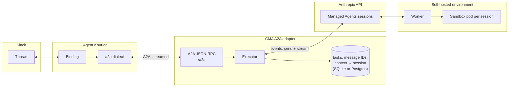
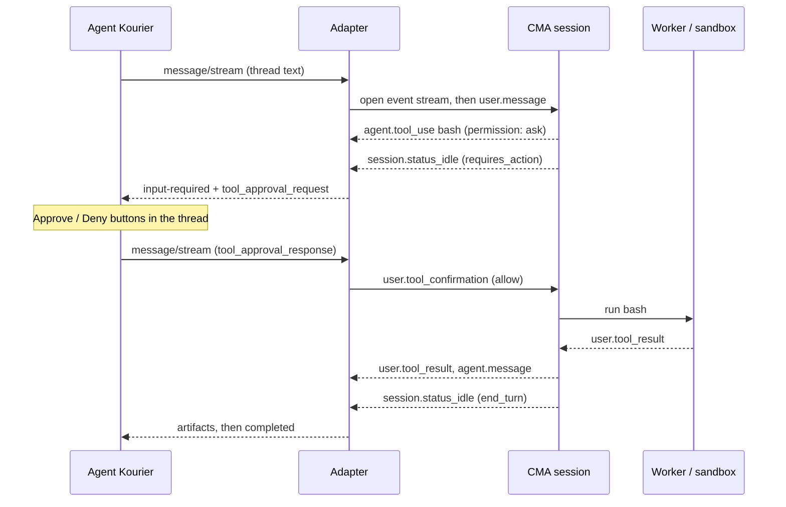

# Claude Managed Agents over A2A

Agent Kourier talks to agents over A2A. Claude Managed Agents (CMA) has no A2A endpoint: it runs the agent loop for
you and exposes sessions through the Anthropic API. This example is an A2A server that sits in front of one CMA agent,
so a Binding drives it with the existing `a2a` dialect and no change to Agent Kourier.

It is experimental. It was tested against a self-hosted CMA environment (the sandbox runs in your own cluster) with a
Haiku agent; it has not been run against a cloud environment.

## How it fits



Agent Kourier owns the chat side: the thread, its session, approvals, timeouts and audit. The adapter only translates. CMA
owns the agent: the model loop, tools and the sandbox the tools run in.

| A2A (what Agent Kourier sees) | CMA (what the adapter does) |
|---|---|
| A context (one Slack thread) | One session, created on the context's first message, with the context ID in its `a2a_context_id` metadata |
| A task | One turn of that session |
| A message's text and data parts | A `user.message` (data parts are sent as JSON text) |
| Artifact text | `agent.message` text |
| ADK `function_call` / `function_response` data parts, which Agent Kourier renders as tool calls | `agent.tool_use` / `agent.mcp_tool_use` and their results; a result is cut to 4000 characters |
| `input-required` with a kagent HITL `tool_approval_request` (Approve/Deny buttons) | A tool call whose permission policy is `always_ask` |
| The HITL `tool_approval_response` | One `user.tool_confirmation` per call; a denial passes its reason on |
| Cancel | `user.interrupt` |
| `completed` | The session idles with `end_turn` |
| `failed` | The session terminates, idles for another reason, the event stream drops, or a sandbox tool gets no result in time (below) |

## A turn with an approval



The adapter opens the session's event stream before it sends anything, because the stream delivers only events that
happen after it opens.

On a self-hosted environment a built-in tool's result comes from the worker as `user.tool_result`, and a tool the agent
may run without asking also idles the session with `requires_action` until that result arrives. The adapter treats
both as waits, not as questions for a person: a pause asks only about the calls that need approval.

## Settings

The adapter is configured through environment variables. A setting it cannot use stops it at start, with an error that
names the variable; the error never shows the value of `POSTGRES_DSN` or `AUTH_HEADER`.

| Variable | Default | What it does |
|---|---|---|
| `CMA_AGENT_ID` | required | The agent to run. Sessions use its latest version. |
| `CMA_ENVIRONMENT_ID` | required | The environment sessions run in. |
| `ANTHROPIC_API_KEY` | | Credentials, read as the Anthropic Go SDK reads them; without it, the active `ant auth login` profile. |
| `LISTEN_ADDR` | `127.0.0.1:8090` | Where the adapter listens. |
| `PUBLIC_URL` | `http://LISTEN_ADDR/a2a` | The endpoint the agent card names; set it to the URL Agent Kourier reaches. |
| `SESSION_IDLE_TTL` | `2160h` | How long a context may go without a turn before its session is archived (checked once a minute, so up to a minute later). `0` never archives. |
| `TOOL_RESULT_TIMEOUT` | `10m` | How long a turn waits, with no session event, for the result of a tool the sandbox runs. `0` waits for ever. |
| `AUTH_TOKEN_FILE` | required | The accepted tokens, one per line. Lines that are blank or start with `#` are skipped, and trailing whitespace (a CR included) is stripped. Re-read every 5 seconds. |
| `AUTH_HEADER` | `Authorization` | The header that carries the token. `Authorization` must be `Bearer <token>` (the scheme in any case); any other header carries the token as its whole value. |
| `AUTH_DISABLED` | `false` | `true` turns the caller check off. Refused unless `LISTEN_ADDR` is a loopback address (`127.0.0.0/8`, `::1` or `localhost`), and refused with `AUTH_TOKEN_FILE` set. |
| `STORE` | `sqlite` | Where tasks, message IDs and sessions are kept: `sqlite` or `postgres`. |
| `SQLITE_PATH` | `cma-addon.db` | The SQLite file, with `STORE=sqlite`. |
| `POSTGRES_DSN` | required with `postgres` | The Postgres connection string, as pgx reads it. Refused with `STORE=sqlite`. |
| `TASK_RETENTION` | `720h` | How long a settled task (completed, failed, canceled or rejected) and its message IDs are kept after its last update; checked once a minute. `0` keeps them. |
| `LEASE_DURATION` / `LEASE_RENEW_DEADLINE` / `LEASE_RETRY_PERIOD` | `15s` / `10s` / `2s` | The leader election (Postgres only, refused with SQLite; see [Replicas](#replicas)). Each must be more than zero, the lease longer than the renew deadline, and the renew deadline longer than 1.2 times the retry period. |
| `ADVERTISE_URL` | required with `postgres` | An `http` or `https` URL where the other replicas reach this one; the store records it with the lease, and standbys forward to it. A bare IPv6 address is bracketed (`http://fd00::1:8090` is read as `http://[fd00::1]:8090`: the last group is the port when what comes before it is an address; bracket it to say otherwise). |
| `POD_NAME` | the hostname | This replica's name as a lease holder. It must differ between replicas: a replica takes a lease held under its own name at once. |
| `LOG_LEVEL` | `info` | `debug`, `info`, `warn` or `error`. Logs are JSON on standard error. |
| `OTEL_EXPORTER_OTLP_ENDPOINT`, `OTEL_EXPORTER_OTLP_TRACES_ENDPOINT` | | Where traces go, over OTLP `http/protobuf`; with neither set, none are exported. The other `OTEL_*` variables Agent Kourier reads are read the same way and refused the same way: `OTEL_TRACES_EXPORTER` (`otlp` or `none`), `OTEL_EXPORTER_OTLP[_TRACES]_PROTOCOL`, `OTEL_EXPORTER_OTLP[_TRACES]_HEADERS`, `OTEL_TRACES_SAMPLER` (`parentbased_traceidratio`) and `OTEL_TRACES_SAMPLER_ARG` (default `1`). |
| `OTEL_SERVICE_NAME` | `agent-kourier-cma` | The traces' `service.name`; `service.version` is the adapter's version. |
| `AGENTKOURIER_ENVIRONMENT` | | The traces' `deployment.environment.name`, when set. |
| `AGENTKOURIER_OTLP_ALLOW_INSECURE_HEADERS` | `false` | `true` lets export headers go to an `http` endpoint; without it, headers with an `http` endpoint stop the adapter at start. |

The adapter serves JSON-RPC at `/a2a`, the agent card at `/a2a/.well-known/agent-card.json`, Prometheus metrics at
`/metrics`, `/healthz`, which answers 200 once it listens, and `/readyz`, which answers 200 on a standby and on the
leader once its start-up work below is done (503 before). Every duration must be a Go duration of zero or more, or the
adapter does not start. `--version` prints the version and exits; the card and the start-up log carry it too.

The adapter exits 0 after a stop on SIGTERM or SIGINT, 2 when a flag, an argument or a setting is wrong, 1 when the
store, CMA or the listener fails, and 5 when it loses the lease (see [Replicas](#replicas)).

### Caller check

A request to `/a2a` must carry one of the tokens in `AUTH_TOKEN_FILE`, or the adapter answers 401 (with
`WWW-Authenticate: Bearer` when the header is `Authorization`) and logs the refusal with its reason, `missing` or
`invalid`, never the value it was given. The card, `/healthz` and `/readyz` need no token. The adapter compares SHA-256
digests of the tokens in constant time, against every token.

Give the Binding the token through `identity.tokenSecretRef`, which Agent Kourier sends as `Authorization: Bearer`; with
`AUTH_HEADER` set to another name, an AgentBackend `headers` entry carries it instead. The file may hold several tokens,
so a new one can be added before the old one is removed. A mounted Secret changes by swapping a symlink, so the file is
read again every 5 seconds rather than watched. If a re-read fails or finds no token, the adapter keeps the tokens it had
and logs the failure, once until the failure changes.

Every accepted token is the same caller, Agent Kourier. The store records it as each task's owner, but tasks are not
kept apart by token: any accepted token reaches every task.

### Store and restarts

The store keeps the A2A tasks, the message IDs that started or joined each task, and each context's session, so a
restart loses none of them. Migrations are applied at start. With SQLite the adapter holds an exclusive lock on
`SQLITE_PATH` plus `.lock` while it runs, so a second adapter on the same file does not start; the file is in WAL mode.
With Postgres, replicas that start together apply each migration once, under an advisory lock.

At start, before it serves, the adapter:

1. Loads each context's session from the store and checks it against the agent's unarchived sessions in the
   environment (it does not start if either cannot be read). A stored session CMA still lists is kept, and CMA's other
   sessions for that context are archived. A context the store lacks adopts the session CMA lists for it (the one
   active last, if there are several; the others are archived). A stored session CMA no longer lists, being archived
   or terminated, is forgotten with its context's tasks, and the context's next message starts a new session.
2. Fails each task left `submitted` or `working` with the agent message "Interrupted by an adapter restart." and sends
   its session an interrupt (a failed interrupt is logged). A task paused on an approval (`input-required`) is kept,
   and an Approve or Deny pressed after the restart reaches the paused calls.

A message whose ID the store has recorded joins that message's task instead of starting another turn, after a restart
too: Agent Kourier resends a message with the same ID when it cannot tell whether the first send arrived.

### Replicas

With SQLite the one adapter always leads. With Postgres, replicas share one database and elect a leader; only the
leader runs turns, and the others are standbys.

- **The lease.** The store holds one lease row: its holder (`POD_NAME`), the holder's `ADVERTISE_URL`, an epoch and an
  expiry, all timed by the database's clock. Every `LEASE_RETRY_PERIOD` a replica tries to take the lease, and takes it
  when it has expired or is held under its own name; each take raises the epoch by one. The leader renews it every
  `LEASE_RETRY_PERIOD` for `LEASE_DURATION`.
- **Losing it.** A leader that has not renewed for `LEASE_RENEW_DEADLINE` (a renewal fails, or finds the lease taken)
  logs why and exits with code 5 at once, without a drain; it stops before its lease runs out. A standby takes the
  lease once `LEASE_DURATION` has passed since the last renewal, at its next try: with the defaults, between 15 and 17
  seconds after the leader stopped renewing.
- **Fencing.** Every write to the store checks, in its own transaction, that the epoch is still the one this replica
  took, and is refused if not; the replica that finds itself deposed exits with code 5. A standby writes nothing.
  A takeover waits up to 4 seconds for the old leader's writes in flight to finish before it raises the epoch, and
  tries again at its next try if they have not.
- **Taking over.** A new leader runs the start-up work above (reconciliation, then failing the interrupted turns),
  starts the reaper, and only then serves; until then `/readyz` and `/a2a` answer 503.
- **Stopping.** On SIGTERM or SIGINT a replica stops taking requests, waits up to 5 seconds for those in flight, and
  then, if it leads, releases the lease, so a standby takes over at its next try instead of when the lease expires.
- **Forwarding.** A standby forwards `/a2a` and the card to the leader the lease names, as they come: a stream is not
  buffered. The caller's headers go with it (the `AUTH_HEADER` token and `traceparent` included), `X-Forwarded-For`
  gains the caller's address, and the standby adds `X-Agent-Kourier-Cma-Forwarded`. The leader checks the token; a
  standby does not. A standby answers 503 with `Retry-After` (`LEASE_RETRY_PERIOD`, rounded up to whole seconds, at
  least 1) when no live lease names another replica, when the leader cannot be reached within 5 seconds (it then reads
  the lease again for the next request), and when a request already carries the forwarding header: a request is
  forwarded once at most.

### Telemetry

`/metrics` serves, besides the Go runtime and process metrics:

| Metric | Labels | What it counts |
|---|---|---|
| `agentkourier_cma_turns_total` | `outcome`: `completed`, `input_required`, `failed`, `canceled`, `timeout`, `interrupted` | Turns, by how they ended. `timeout` is a turn that waited `TOOL_RESULT_TIMEOUT`; `interrupted` is a turn the leader failed at start-up. |
| `agentkourier_cma_operation_duration_seconds` | `operation`: `create_session`, `stream`, `send`, `list_sessions`, `archive`; `outcome`: `success`, `cancelled`, `timeout`, the HTTP status, or `error` | Calls to the Managed Agents API (for `stream`, opening it). |
| `agentkourier_cma_auth_refused_total` | `reason`: `missing`, `invalid` | Requests the caller check answered 401. |
| `agentkourier_cma_sessions_archived_total` | `reason`: `idle`, `superseded`, `gone` | Sessions let go of: archived after `SESSION_IDLE_TTL`, archived as a context's extra session, or forgotten because CMA no longer lists them. |
| `agentkourier_cma_message_replays_total` | | Messages that joined the task their ID started. |
| `agentkourier_cma_tasks_interrupted_total` | | Tasks the leader failed at start-up. |
| `agentkourier_cma_sessions` | | Contexts with a session in this replica's memory (none on a standby). |
| `agentkourier_cma_leader` | | 1 while this replica runs turns, 0 on a standby. |
| `agentkourier_cma_leader_takeovers_total` | | Times this replica took the lease. |
| `agentkourier_cma_forwarded_requests_total` | `outcome`: `forwarded`, `failed`, `cancelled`, `no_leader`, `loop` | Requests a standby forwarded, or answered 503 instead. |

With an OTLP endpoint set, each turn is a span, `agentkourier.cma.turn`, a child of the span in the request's
`traceparent` (Agent Kourier's), with the attributes `agentkourier.task.id`, `agentkourier.context.id` and
`agentkourier.outcome`; each call to the API is a child span, `agentkourier.cma.backend.<operation>`. No span or log
carries message text, tool input or a token.

### Session lifecycle

A CMA session holds its sandbox until it is archived. The store keeps each context's session, and each session carries
its context ID in its `a2a_context_id` metadata, from which the adapter can find it again (above).

`SESSION_IDLE_TTL` archives a context's session once the context has had no turn for that long, and deletes the
context's tasks from before the archive, with their message IDs: they belong to the archived session. Archiving cannot
be undone: the context's next message starts a new session without the old history. Set it to the Binding's
`session.threadTTL` (Agent Kourier's default is `2160h`); past that, Agent Kourier gives the thread a new context and the
old session is never used again. A shorter value archives sessions a thread can still continue.

This setting does not free an idle sandbox's memory; the environment's own idle timeout does that.

### A sandbox that never starts

A self-hosted sandbox that cannot be scheduled (a full node, for instance) sends no event at all: the session just
waits. When a turn waits on a tool the sandbox runs (an allowed call, or one a person approved) and no session event
arrives for `TOOL_RESULT_TIMEOUT`, the adapter interrupts the session and fails the task with status metadata
`code: timeout`. Agent Kourier shows its fixed timeout notice in the thread; the adapter's own message names the sandbox
and the timeout. A tool that runs silently for longer than the timeout is cut off the same way, so set it above your
slowest command.

The wait covers built-in tools only: MCP tools do not run in the sandbox, and a model that is thinking is not waiting
on one.

### Keeping the stream open

Agent Kourier cuts a stream that has been silent for 5 minutes and reconnects to the task. The adapter sends a `working` update after every 60 seconds
without a session event, so a slow turn is not cut off.

## Run it with Slack on kind

`kind/` holds what the end-to-end test used: Agent Kourier in a kind cluster, the adapter on the Docker host.

1. Create a CMA agent with bash set to `always_ask` (so approvals show up) and a self-hosted environment whose worker
   runs in your cluster.
2. Create a Slack app from `kind/slack-app-manifest.yaml`, install it, create an app-level token with
   `connections:write`, and invite the bot to the test channel.
3. Run the adapter on the host. Kind nodes reach the host as `host.docker.internal`:

   ```sh
   cd addons/cma
   printf '%s' "$(openssl rand -hex 32)" > cma-token
   CMA_AGENT_ID=agent_... CMA_ENVIRONMENT_ID=env_... AUTH_TOKEN_FILE=cma-token \
   LISTEN_ADDR=0.0.0.0:8090 PUBLIC_URL=http://host.docker.internal:8090/a2a \
   go run ./cmd/adapter
   ```

   The token file has no trailing newline: Agent Kourier sends the Secret's value as it is, and refuses one with a
   control character. The adapter keeps its state in `cma-addon.db` in the working directory.
4. Build and load the image (`make image`, then `kind load docker-image agent-kourier:dev --name <cluster>`), create the `slack` Secret
   (`botToken`, `appToken`) and the `cma-adapter-token` Secret
   (`kubectl -n agent-kourier create secret generic cma-adapter-token --from-file=token=cma-token`) in the
   `agent-kourier` namespace, replace `C0123456789` in `kind/config/kourier.yaml` with the
   channel's ID, create the `cma-kourier-config` ConfigMap from it (key `kourier.yaml`), and install the chart with
   `kind/values.yaml`.
5. Mention the bot in the channel. Replies in the thread continue the same session.

## Test it

Unit tests use a fake backend and spend nothing. The store's tests run on SQLite, and on Postgres too when
`AGENTKOURIER_POSTGRES_DSN` names one (each test makes and drops a schema of its own):

```sh
cd addons/cma && go test -race ./...
```

`livecheck` is a separate module that drives a running adapter with Agent Kourier's own A2A client and `a2a` dialect, the
code a Binding uses. Its offline test runs against a scripted backend, behind the caller check; its live scenarios (`text`, `allowed`, `approve`,
`continuity`, `deny`, `cancel`) need an agent with bash set to `always_ask` and spend model tokens. `ONLY=text,deny`
runs a subset.

```sh
cd addons/cma/livecheck
go test -race ./...
ADAPTER_URL=http://127.0.0.1:8090/a2a ADAPTER_TOKEN="$(cat ../cma-token)" go run .
```

CI's `cma` job runs `hack/postgres/run.sh make cma-test` and `make cma-lint`.

## Limits

- **One replica runs turns.** With SQLite the file lock keeps a second adapter from starting on the same file. With
  Postgres more replicas give a quicker takeover, not more capacity: standbys forward to the leader.
- **A takeover is not instant.** When the leader dies without releasing the lease, requests get 503 until a standby
  takes over (with the defaults, up to 17 seconds) and finishes its start-up work. A leader that cannot reach the
  database stops after `LEASE_RENEW_DEADLINE`.
- **A takeover fails the turns in flight.** A turn the old leader was running, and the stream a standby forwarded for
  it, end with that leader; the new leader fails the task as a restart does.
- **Store calls have no deadline of their own.** On Postgres, a statement is cut at 30 seconds and a transaction left
  idle at 10, unless `POSTGRES_DSN` sets `statement_timeout` or `idle_in_transaction_session_timeout`.
- **One caller.** Every accepted token is Agent Kourier; tasks are not kept apart by token.
- **A restart fails the turns in flight.** A turn that was running when the adapter stopped is failed at the next
  start, and its session interrupted; Agent Kourier shows the failure in the thread. A paused approval survives.
- **Approvals need the buttons.** A plain-text reply cannot approve or deny a tool call; the adapter refuses it and the
  task stays paused.
- **No custom tools.** A pause on a custom tool, or on any call the turn did not see ask for approval, fails the turn.
- **Text only.** Messages carry text and data parts; files and images are refused, and the agent's non-text output
  blocks are not shown.
- **Mixed pauses.** If one pause names both an allowed sandbox call and a call that needs approval, the turn that
  resumes after the approval did not see the allowed call start. If the session idles on that call again, the turn
  fails as an action the adapter cannot answer.
- **Session errors are logged only.** A `session.error` event is written to the adapter's log; the turn goes on until
  the session idles or terminates.
