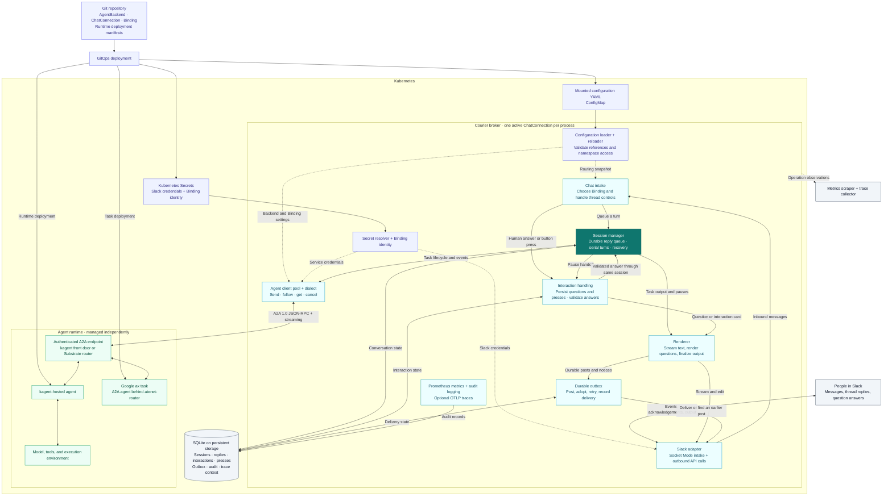

# Architecture

Courier connects declarative messaging bindings to agents deployed with a chosen
runtime. The runtime hosts and executes the agents. Courier owns the messaging
connection, conversation lifecycle, and delivery state.

The [README](../README.md#how-it-works) shows the basic idea. This diagram expands
the current broker and shows both supported runtime paths, kagent and Google ax.

Solid arrows show the implemented configuration and conversation paths. Dotted
arrows inside the broker show configuration or credential inputs. The kagent and
ax runtimes sit behind the same A2A client; they differ only in dialect and in
what the backend exposes. Telemetry is shared across broker operations, rather
than a required step in message delivery. Audit records are durable in SQLite;
traces are exported only when configured.

## Configuration and deployment

The current pilot reads resource-shaped YAML files from `COURIER_CONFIG_DIR`.
GitOps deploys those files as a ConfigMap alongside Secrets, the Courier
Deployment, and persistent storage. The reloader validates changes and keeps the
last accepted configuration if a reload fails. Secret access uses Kubernetes
RBAC; cross-namespace resource references use configured namespace allowlists.

The broker selects one active `ChatConnection` per process. Multiple bindings
can route its channels to different agents and backends. The current deployment
uses SQLite; this diagram does not imply an active-active, shared-database broker.

Live Courier CRDs and a reconciliation controller are planned. Courier does not
deploy an agent when it loads an `AgentBackend` or `Binding`: the runtime's own
manifests, operator, or deployment tooling handle that lifecycle.

## One conversation

1. The messaging adapter feeds an inbound message to chat intake, which selects
   the binding and applies the channel and thread rules.
2. The session manager persists the reply and runs turns in order. The agent
   client uses the binding's service identity and backend dialect to call A2A.
3. Task output feeds the renderer. Live streams and edits go through the chat
   adapter; durable posts and notices go through the outbox.
4. When the agent needs a human answer, interaction handling persists the pause
   and renders its question. An accepted answer resumes the same agent task.
5. On restart, persisted sessions, pending interactions, and outbound rows allow
   recovery and reconciliation. Saved trace context connects asynchronous work.

Structured questions and approvals depend on the backend's interaction contract.
The generic A2A dialect supports text continuation: a plain-text `input-required`
question is persisted and posted, and a thread reply is accepted under the same
membership, audit and deadline checks as a button press before it is sent to the
paused task. The kagent dialect additionally understands its structured HITL
extension (tool approvals, tool step cards).

Google ax is a supported backend. ax speaks A2A, so it uses the `a2a` dialect with
no ax-specific code. The `AgentBackend` points at ax's `atenet-router` and selects
the actor with a static `ate-target-actor` header from `spec.headers`; the agent is
an A2A server running as an ax task, which you build and run (ax ships none). No
front door sits in this path, so the agent must verify the Binding's bearer ID token
itself, as the reference agent does (issuer, audience and subject), or an
OIDC-verifying proxy must sit in front of a TLS gateway to the router. Chat, queued replies, restart recovery, actor suspend and resume, and
in-thread text answers are tested in the AX kind tier. Structured tool approvals and
tool step cards are kagent-only; the generic dialect leaves them opaque. ax's own
lifecycle (task, template, egress policy) stays with the operator. See the
[AX reference agent](../examples/ax/README.md) and the
[AX kind tier](../hack/kind/ax/README.md).

## Source map

| Responsibility | Source |
|---|---|
| Resource types | [`api/v1alpha1`](../api/v1alpha1) |
| Composition and shutdown | [`internal/broker`](../internal/broker) |
| Configuration and Secret resolution | [`internal/config`](../internal/config) |
| Messaging contracts and Slack adapter | [`internal/chat`](../internal/chat) |
| Conversation execution and recovery | [`internal/session`](../internal/session) |
| A2A clients and backend behavior | [`internal/agent`](../internal/agent), [`internal/dialect`](../internal/dialect) |
| Human interactions | [`internal/interact`](../internal/interact) |
| Output and durable delivery | [`internal/render/live`](../internal/render/live), [`internal/outbox`](../internal/outbox) |
| Persistence and observations | [`internal/store/sqlite`](../internal/store/sqlite), [`internal/telemetry`](../internal/telemetry), [`internal/audit`](../internal/audit) |

See the [specification](../spec.md#6-architecture) for the detailed contracts and
[observability guide](observability.md) for metrics and trace boundaries.
