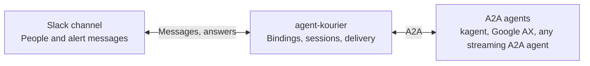
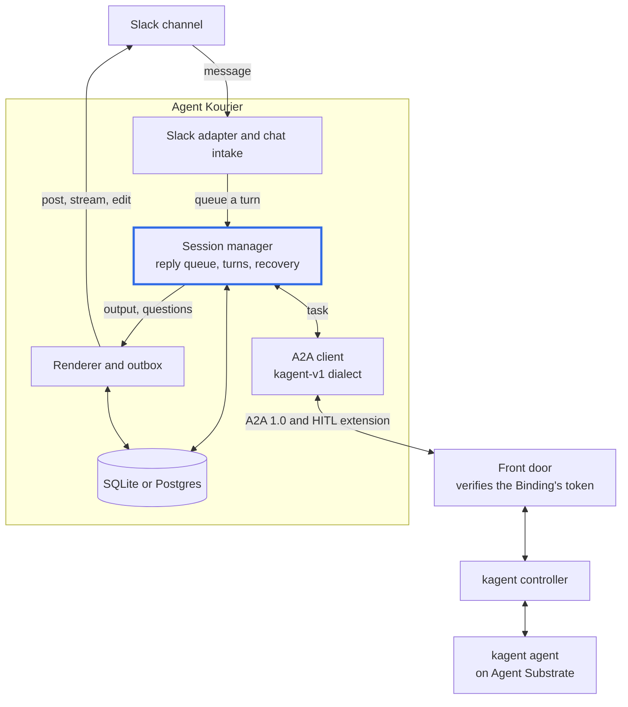
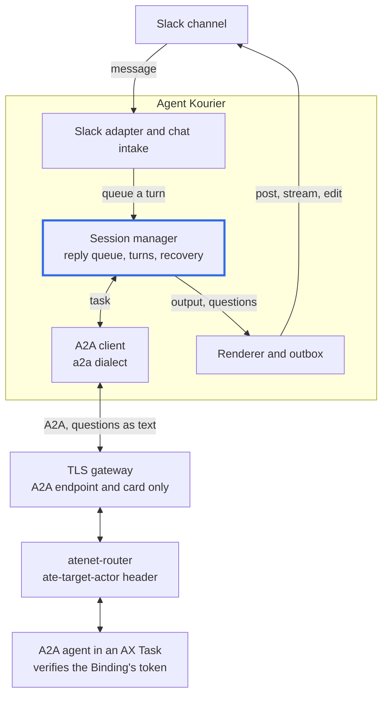

# Architecture

This page explains how Agent Kourier is put together: what it owns, what the agent runtime owns, and the path one
conversation takes through the broker.

Agent Kourier connects declarative messaging bindings to agents deployed with a chosen runtime. The runtime hosts and
executes the agents. Agent Kourier owns the messaging connection, conversation lifecycle, and delivery state.

## The kagent path

A message from Slack becomes a turn in the session manager, which sends it to the agent through the `kagent-v1`
dialect. Every call goes through a front door that verifies the Binding's token; the controller port is never reached
directly. The answer streams back and is rendered into the thread, and durable posts go through the outbox.

## The Google AX path

The broker is the same; only the dialect and what sits in front of the agent differ. AX has no message model of its
own, so the agent is an A2A server you build and run as an AX Task, and it verifies the Binding's token itself.

## The whole map

The full map adds configuration, Secrets, interaction handling, telemetry and both runtimes in one picture. It is
too large to read at page width: open it full size.

<figure class="ak-map" markdown>
{ .on-glb width="640" }
<figcaption markdown>The full map. Select it to open it, and select it again to see it at full size and drag it; or [open the SVG](../assets/diagrams/architecture-map.svg) in a tab of its own.</figcaption>
</figure>

In the full map, solid arrows show the configuration and conversation paths, and dotted arrows show configuration or
credential inputs. The kagent and AX runtimes sit behind the same A2A client; they differ only in dialect and in what
the backend exposes. Telemetry is shared across broker operations rather than a step in delivery. Audit records are
durable in the store; traces are exported only when configured.

## Configuration and deployment

Agent Kourier reads resource-shaped YAML files from `AGENTKOURIER_CONFIG_DIR`.
GitOps deploys those files as a ConfigMap alongside Secrets, the Agent Kourier
Deployment, and persistent storage. The reloader validates changes and keeps the
last accepted configuration if a reload fails. Secret access uses Kubernetes
RBAC; cross-namespace resource references use configured namespace allowlists.

The config must hold exactly one `ChatConnection`; the broker refuses to start with more. Multiple bindings
can route its channels to different agents and backends. The store is SQLite with
one replica, or Postgres with one or two replicas (two are active and passive) (see
[High availability](high-availability.md)); the broker is never active-active.

Live Agent Kourier CRDs and a reconciliation controller are planned. Agent Kourier does not
deploy an agent when it loads an `AgentBackend` or `Binding`: the runtime's own
manifests, operator, or deployment tooling handle that lifecycle.

## One conversation

1. The messaging adapter feeds an inbound message to chat intake, which selects
   the binding and applies the channel and thread rules.
2. The session manager persists the reply and runs turns in order. The agent
   client uses the binding's service identity and backend dialect to call A2A.
3. Task output feeds the renderer. Live streams and edits go through the chat
   adapter; durable posts and notices go through the outbox.
4. When the agent needs a human answer, interaction handling persists the pause
   and renders its question. An accepted answer resumes the same agent task.
5. On restart, persisted sessions, pending interactions, and outbound rows allow
   recovery and reconciliation. Saved trace context connects asynchronous work.

Structured questions and approvals depend on the backend's interaction contract.
The generic A2A dialect supports text continuation: a plain-text `input-required`
question is persisted and posted, and a thread reply is accepted under the same
membership, audit and deadline checks as a button press before it is sent to the
paused task. The kagent dialect additionally understands structured questions and
tool step cards. A tool approval request is denied, and the thread is told.

Google AX is supported experimentally. AX speaks A2A, so it uses the `a2a` dialect with
no ax-specific code. The `AgentBackend` points at ax's `atenet-router` and selects
the actor with a static `ate-target-actor` header from `spec.headers`; the agent is
an A2A server running as an ax task, which you build and run (ax ships none). No
front door sits in this path, so the agent must verify the Binding's bearer ID token
itself, as the reference agent does (issuer, audience and subject), or an
OIDC-verifying proxy must sit in front of a TLS gateway to the router. Chat, queued replies, restart recovery, actor suspend and resume, and
in-thread text answers are tested in the AX kind tier. Structured tool approvals and
tool step cards are kagent-only; the generic dialect shows no tool steps, and a structured pause cancels the task with a notice. ax's own
lifecycle (task, template, egress policy) stays with the operator. See the
[AX reference agent](https://github.com/agentkourier/agent-kourier/blob/main/examples/ax/README.md) and the
[AX kind tier](https://github.com/agentkourier/agent-kourier/blob/main/hack/kind/ax/README.md).

## Source map

| Responsibility | Source |
|---|---|
| Resource types | [`api/v1alpha1`](https://github.com/agentkourier/agent-kourier/tree/main/api/v1alpha1) |
| Composition and shutdown | [`internal/broker`](https://github.com/agentkourier/agent-kourier/tree/main/internal/broker) |
| Configuration and Secret resolution | [`internal/config`](https://github.com/agentkourier/agent-kourier/tree/main/internal/config) |
| Messaging contracts and Slack adapter | [`internal/chat`](https://github.com/agentkourier/agent-kourier/tree/main/internal/chat) |
| Conversation execution and recovery | [`internal/session`](https://github.com/agentkourier/agent-kourier/tree/main/internal/session) |
| A2A clients and backend behavior | [`internal/agent`](https://github.com/agentkourier/agent-kourier/tree/main/internal/agent), [`internal/dialect`](https://github.com/agentkourier/agent-kourier/tree/main/internal/dialect) |
| Human interactions | [`internal/interact`](https://github.com/agentkourier/agent-kourier/tree/main/internal/interact) |
| Output and durable delivery | [`internal/render/live`](https://github.com/agentkourier/agent-kourier/tree/main/internal/render/live), [`internal/outbox`](https://github.com/agentkourier/agent-kourier/tree/main/internal/outbox) |
| Persistence and observations | [`internal/store/sqlite`](https://github.com/agentkourier/agent-kourier/tree/main/internal/store/sqlite), [`internal/store/postgres`](https://github.com/agentkourier/agent-kourier/tree/main/internal/store/postgres), [`internal/telemetry`](https://github.com/agentkourier/agent-kourier/tree/main/internal/telemetry), [`internal/audit`](https://github.com/agentkourier/agent-kourier/tree/main/internal/audit) |

See [Logs and traces](../reference/logs-and-traces.md) for the trace boundaries.
