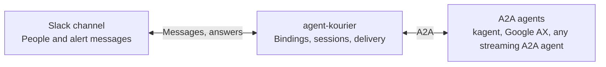
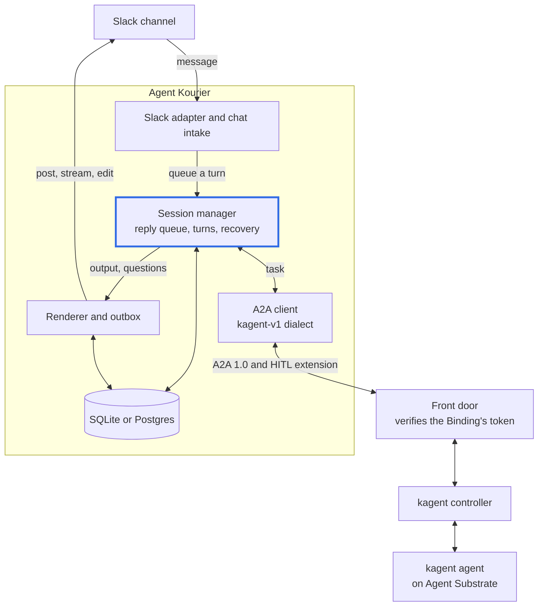
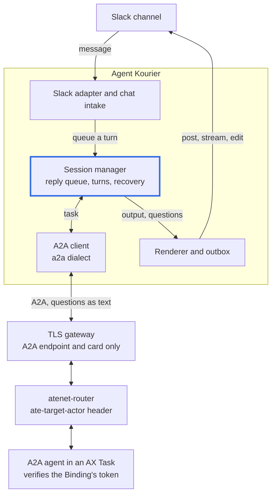
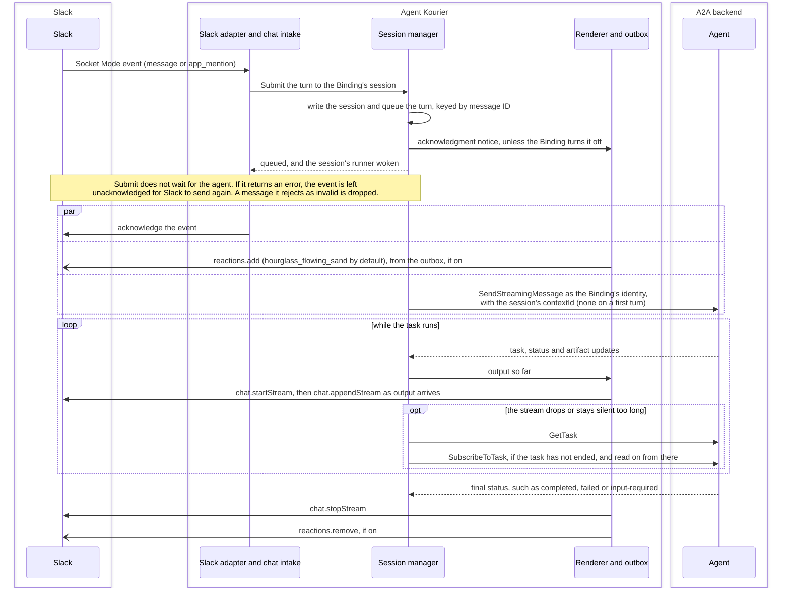
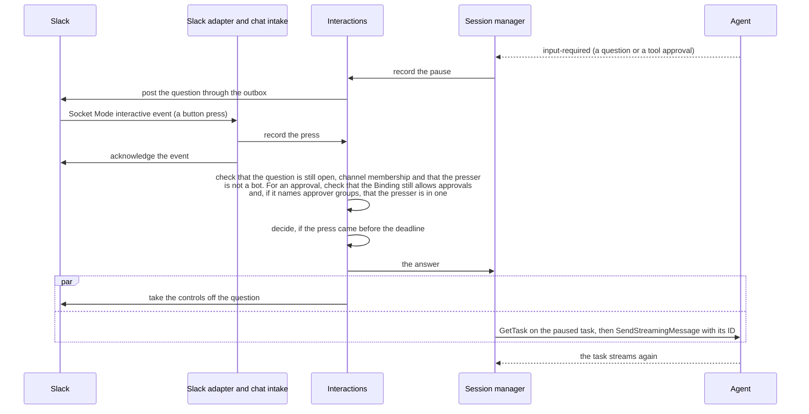

# Architecture

This page explains how Agent Kourier is put together: what it owns, what the agent runtime owns, and the path one
conversation takes through the broker.

Agent Kourier connects declarative messaging bindings to agents deployed with a chosen runtime. The runtime hosts and
executes the agents. The agents own their tools and task logic. Agent Kourier owns the messaging connection,
conversation lifecycle, and delivery state. An agent that exposes a supported streaming A2A endpoint can connect through
a `Binding` without adding Slack event handlers or reply formatting to the agent.

## The kagent path

A message from Slack becomes a turn in the session manager, which sends it to the agent through the `kagent-v1`
dialect. Every call goes through a front door that verifies the Binding's token; the controller port is never reached
directly. The answer streams back and is rendered into the thread, and durable posts go through the outbox.

## The Google AX path

The broker is the same; only the dialect and what sits in front of the agent differ. AX has no message model of its
own, so the agent is an A2A server you build and run as an AX Task, and it verifies the Binding's token itself.

## The whole map

The full map adds configuration, Secrets, interaction handling, telemetry and both runtimes in one picture. It is
too large to read at page width: open it full size.

<figure class="ak-map" markdown>
{ .on-glb width="640" }
<figcaption markdown>The full map. Select it to open it, and select it again to see it at full size and drag it; or [open the SVG](../assets/diagrams/architecture-map.svg) in a tab of its own.</figcaption>
</figure>

In the full map, solid arrows show the configuration and conversation paths, and dotted arrows show configuration or
credential inputs. The kagent and AX runtimes sit behind the same A2A client; they differ only in dialect and in what
the backend exposes. Telemetry is shared across broker operations rather than a step in delivery. Audit records are
durable in the store; traces are exported only when configured.

## Configuration and deployment

Agent Kourier reads three kinds of resource, `ChatConnection`, `AgentBackend` and `Binding`, from one of two places, chosen when
it starts. With the chart's `config.source: crds`, its default, it reads the three kinds from the cluster as custom resources, one object
at a time, so that teams can own their Bindings; there is no reconciliation controller, since the broker watches them itself, and the elected
leader writes each Binding's `status`. With `config.source: files`, the quick route for a proof of concept, it reads resource-shaped YAML files from `AGENTKOURIER_CONFIG_DIR`, which GitOps deploys as a ConfigMap alongside
Secrets, the Agent Kourier Deployment and persistent storage; the reloader validates changes and, if a reload fails, keeps the last accepted
configuration. The two routes are never merged. [Choose a config route](config-routes.md) says how they differ. Secret
access uses Kubernetes RBAC; cross-namespace resource references use configured namespace allowlists.

A broker serves its own `ChatConnection`, and with custom resources the `ChatConnection`s of the namespaces the platform team admits, up to 16 in all: see [One ChatConnection](config-routes.md#which-chatconnections-a-broker-serves) for how the own one is chosen on each route, and [Let a team bring its own Slack app](../how-to/team-slack-app.md) for the others. Multiple bindings
can route a connection's channels to different agents and backends. The store is SQLite with
one replica, or Postgres with one or two replicas (two are active and passive) (see
[High availability](high-availability.md)); the broker is never active-active.

Agent Kourier does not
deploy an agent when it loads an `AgentBackend` or `Binding`: the runtime's own
manifests, operator, or deployment tooling handle that lifecycle.

## One conversation

A turn crosses two protocols. Slack delivers events to Agent Kourier over a Socket Mode connection, and Agent Kourier
writes to Slack through its Web API. Agent Kourier calls the agent over A2A and reads the reply as a stream. The first
diagram follows one message in a chat thread; the second shows what happens when the agent pauses for an answer.

A turn that no person wrote, such as the one an alert starts, has no one to show a stream to, so its reply is a
`chat.postMessage` through the outbox, followed by `chat.update` calls as output arrives. A person's reply in that
thread streams as above. With `output: final`, the reply is posted once, when the turn ends.

If the agent rejects the answer with a JSON-RPC internal error (`-32603`), Agent Kourier cancels the paused task and
posts a notice in the thread.

A question that takes a typed answer is answered by a reply in the thread instead of a button. The reply comes in as
a Socket Mode message event and Submit queues it. A session waiting on the question reads the paused task and passes
the reply to interactions, which check it as they check a press. A reply that is not taken as the answer stays queued
as an ordinary turn, unless intake already tied it to the question.

1. The messaging adapter feeds an inbound message to chat intake, which selects
   the binding and applies the channel and thread rules.
2. The session manager persists the reply and runs turns in order. The agent
   client uses the binding's service identity and backend dialect to call A2A.
3. Task output feeds the renderer. Live streams and edits go through the chat
   adapter; durable posts and notices go through the outbox.
4. When the agent needs a human answer, interaction handling persists the pause
   and renders its question. An accepted answer resumes the same agent task.
5. On restart, persisted sessions, pending interactions, and outbound rows allow
   recovery and reconciliation. Saved trace context connects asynchronous work.

Structured questions and approvals depend on the backend's interaction contract.
The generic A2A dialect supports text continuation: a plain-text `input-required`
question is persisted and posted, and a thread reply is accepted under the same
membership, audit and deadline checks as a button press before it is sent to the
paused task. For an agent whose card lists kagent's human-in-the-loop extension, the
generic dialect asks for that extension and reads its structured questions and tool
approvals as the kagent dialect does. Any other pause with a part that is not text is
unusable on that dialect and cancels the task, and a kagent approval pause made without
the extension arrives as text alone (recorded with kagent 1.0.0-alpha5), so it is handled
as a question and its reply is sent as plain text, never as an approval.
The kagent dialect always understands structured questions. Tool step cards do
not depend on the dialect: every dialect shows the tool calls and results that an
agent marks as Google ADK or kagent does. A Binding enables its tool approval prompt with `interactions.toolApprovals`;
optional `approverGroups` narrow the eligible Slack users, while ask-user answers
remain independent. A disabled approval is denied through the dialect with a
thread notice. A pinned kagent 1.0.0-alpha5 runtime check approved `add_numbers`
and denied `check_status` in one two-tool pause; only `add_numbers` executed. The
broker's end-to-end suite verifies this with fake Slack and pinned kagent 1.0.0-alpha5.

Google AX is supported experimentally. AX speaks A2A, so it uses the `a2a` dialect with
no ax-specific code. The `AgentBackend` points at ax's `atenet-router` and selects
the actor with a static `ate-target-actor` header from `spec.headers`; the agent is
an A2A server running as an AX Task, which you build and run (AX does not ship one). No
front door sits in this path, so the agent must verify the Binding's bearer ID token
itself, as the reference agent does (issuer, audience and subject), or an
OIDC-verifying proxy must sit in front of a TLS gateway to the router. Chat, queued replies, restart recovery, actor suspend and resume, and
in-thread text answers are tested in the AX kind tier. Structured tool approvals
need kagent's human-in-the-loop extension, which the reference agent does not serve, so a pause with a part that is not text cancels the task with a notice. The generic dialect shows tool steps for an agent
that marks its tool parts as Google ADK or kagent does. AX's own
lifecycle (task, template, egress policy) stays with the operator. See the
[AX reference agent](https://github.com/agentkourier/agent-kourier/blob/main/examples/ax/README.md) and the
[AX kind tier](https://github.com/agentkourier/agent-kourier/blob/main/hack/kind/ax/README.md).

## Source map

| Responsibility | Source |
|---|---|
| Resource types | [`api/v1alpha1`](https://github.com/agentkourier/agent-kourier/tree/main/api/v1alpha1) |
| Composition and shutdown | [`internal/broker`](https://github.com/agentkourier/agent-kourier/tree/main/internal/broker) |
| Configuration and Secret resolution | [`internal/config`](https://github.com/agentkourier/agent-kourier/tree/main/internal/config) |
| Messaging contracts and Slack adapter | [`internal/chat`](https://github.com/agentkourier/agent-kourier/tree/main/internal/chat) |
| Conversation execution and recovery | [`internal/session`](https://github.com/agentkourier/agent-kourier/tree/main/internal/session) |
| A2A clients and backend behavior | [`internal/agent`](https://github.com/agentkourier/agent-kourier/tree/main/internal/agent), [`internal/dialect`](https://github.com/agentkourier/agent-kourier/tree/main/internal/dialect) |
| Binding verification | [`internal/bindingcheck`](https://github.com/agentkourier/agent-kourier/tree/main/internal/bindingcheck), [`internal/broker`](https://github.com/agentkourier/agent-kourier/tree/main/internal/broker) |
| Human interactions | [`internal/interact`](https://github.com/agentkourier/agent-kourier/tree/main/internal/interact) |
| Output and durable delivery | [`internal/render/live`](https://github.com/agentkourier/agent-kourier/tree/main/internal/render/live), [`internal/outbox`](https://github.com/agentkourier/agent-kourier/tree/main/internal/outbox) |
| Persistence and observations | [`internal/store/sqlite`](https://github.com/agentkourier/agent-kourier/tree/main/internal/store/sqlite), [`internal/store/postgres`](https://github.com/agentkourier/agent-kourier/tree/main/internal/store/postgres), [`internal/telemetry`](https://github.com/agentkourier/agent-kourier/tree/main/internal/telemetry), [`internal/audit`](https://github.com/agentkourier/agent-kourier/tree/main/internal/audit) |

See [Logs and traces](../reference/logs-and-traces.md) for the trace boundaries.
