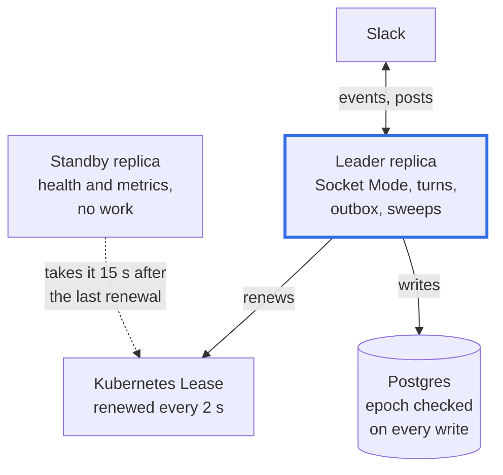

# High availability and failover

This page explains how Agent Kourier runs as two replicas, how one of them is chosen to do the work, what happens when
it fails, and the duplicates a failover can still produce.

## One leader, one standby

High availability is active/passive. Two replicas of one Deployment share a Postgres database. One is the **leader**:
it holds a Kubernetes Lease and runs all of Agent Kourier's work, which is the Socket Mode connection, the session
runners, the outbox, the sweeps and the digests. The other is the **standby**: it serves health and metrics and waits
for the Lease.

Active/active, with workers on every replica, is deferred until one replica's throughput is not enough. With one
writer there is one place where turns are ordered, one Socket Mode connection, and one outbox, so every recovery rule
of a single replica holds unchanged.

## SQLite or Postgres

SQLite, the default store, is one file on a volume that one pod may use. With SQLite there is one replica and no
election: the chart refuses `replicaCount` above 1. With `store.type: postgres` the replicas elect a leader, and at
`replicaCount: 1` the one replica elects itself and leads with no standby.

## The Lease and its timings

The replicas hold one Lease, `<fullname>-leader` in the release namespace. Three timings, set by the chart's
`leaderElection` values or the `AGENTKOURIER_LEASE_*` variables, decide how a takeover goes:

| Timing | Default | Meaning |
|---|---|---|
| `leaseDuration` | 15 s | A standby takes the Lease this long after the last renewal it saw. |
| `renewDeadline` | 10 s | The leader keeps trying to renew for this long, then gives up and exits at once. |
| `retryPeriod` | 2 s | How often the leader renews, and the standby tries. |

The leader gives up 5 s before a standby may take over, so in the normal case the old leader has stopped before the new
one starts. The timings must satisfy `leaseDuration > renewDeadline > 1.2 × retryPeriod`.

- **A crash or a lost node:** work resumes about a lease duration after the last renewal, 15 s, plus the new leader's
  start-up.
- **A stop on a signal (a deleted pod, a rolling update, a drain):** the leader keeps renewing the Lease through its
  ordered shutdown (up to 25 s), so a new leader never starts beside one that is still draining. After its ordered
  shutdown it hands the Lease over, and a standby takes it at its next attempt a few seconds later (a retry period,
  2 s, plus up to 120% jitter).
- **The API server unreachable from the leader:** renewal fails, and the leader exits after the renew deadline.

## Fencing: when the timing is not enough

A leader can be paused rather than dead: a long garbage-collection pause, a frozen node, or a partition from the API
server but not from Postgres or Slack. Its Lease passes to the standby while it still runs. Three defences stop it from
writing to the store and the chat, and from sending to the agent, as a second leader. A call that was already in flight
when the pause began is out of their reach; see [the duplicate that can still happen](#the-duplicate-that-can-still-happen).

**Epoch fencing in Postgres.** The database holds one row, `leadership(epoch, holder, since)`. A replica that takes the
Lease increments the epoch and keeps the number. Every write transaction of the Postgres store first checks the
epoch against its own, and a mismatch aborts the transaction. A deposed leader's next write to the store therefore
fails, and the process exits at once with code 5, with no graceful drain, since a drain would post. Kubernetes restarts
it, and it comes back as the standby.

**Chat writes fenced on the replica.** A paused leader can resume with a Slack stream open, and a stream is many calls.
So every write to the chat (a post, an edit, a stream's start, append and stop, an ephemeral, a reaction) is refused,
and the process stopped, once the monotonic clock is past the last accepted renewal of the Lease plus the renew
deadline. The monotonic clock keeps counting through a pause, so the first call after one sees a stale Lease. Reads
pass. With SQLite there is no Lease, and this fence is not installed.

**Calls to the agent fenced on the replica.** The same check on the Lease clock guards the calls that change what the
agent holds: sending a turn, answering a pause (a question or a tool approval) and cancelling a task. A leader that
resumes after a pause with a reply already queued, or an answer already recorded, would otherwise read it and send it
before its first write to the store or the chat. Past the renew deadline the call is refused, it never reaches the
agent, and the process is stopped with exit code 5. The refused turn is not lost: it is still queued, because the
refusal ends the process before anything marks it delivered (a sent turn leaves the queue when the agent names its task), and
the new leader's recovery sends it. As after any
restart, a turn of a session that already has a context is looked up on the agent first. A recorded answer stays recorded as answered, and the new leader sends it again when it
finds the task paused. Calls that only read pass: getting a task, looking up a turn by its message ID, and following a
task.

## What the standby does

The standby is Ready: readiness never depends on the Lease, because nothing routes traffic to Agent Kourier in Socket
Mode and a standby is healthy. It serves `/healthz`, `/readyz` and `/metrics`, keeps its configuration and Secret
caches fresh, and does no work. It opens no Socket Mode connection: Slack sends each event to one of an app's open
connections, so a second connection would send a share of them to a replica that does nothing.

`agentkourier_leader` is 1 on the leader and 0 on the standby, and `agentkourier_leader_takeovers_total` counts the times
a replica took the leadership.

## A takeover is a restart

On taking the Lease, a replica runs the leader's half of the start-up exactly as a start-up after a crash runs it. The
new leader takes the next epoch, reconciles the outbox, recovers the sessions' tasks and connects to Slack, and every
recovery rule of a single replica applies: posts are adopted by their tag rather than repeated, a task is looked up
before a turn is resent, and a recovered stream escapes everything.

- **A stream the old leader left open.** The session records which turn a task belongs to, so the new leader renders
  the recovered task under that turn: it finds the turn's outbox row and stream, ends the stream, and replaces the
  half-written message with the whole output, with the cards the stream would show before the text: each tool call's, or
  in the activity modes the `Working…` or activity card.
- **Slack events.** Agent Kourier acknowledges an event only after its turn is queued, so an event the old leader took
  and did not acknowledge is delivered again. If both replicas are briefly connected while one is paused, a message
  delivered to both is still one turn, because turns are queued by message ID.

## Drains, upgrades and placement

A takeover is cheap only if the two replicas do not fail together, and Kubernetes' voluntary disruptions, a node drain
or an upgrade, are where they could.

- **Upgrades.** On Postgres the Deployment rolls with one surge and none unavailable: a new pod starts, as a standby,
  before an old one stops, so an upgrade never leaves zero replicas. An old leader stops on its signal, finishes its
  ordered shutdown (up to 25 seconds, inside the pod's 40 seconds of termination grace) and hands the Lease over. On
  SQLite the strategy is `Recreate`, because the ReadWriteOnce volume can be attached to one pod at a time.
- **Drains.** The chart can render a PodDisruptionBudget (`podDisruptionBudget.enabled`, off by default). One with `minAvailable: 1` lets a drain take one replica and makes it wait for that one to
  return before it takes the other. The chart refuses a budget that would block every voluntary eviction, since a
  drain that can never finish is its own outage.
- **Placement.** Two replicas on one node fail together. The chart takes a free-form `affinity`, `nodeSelector`,
  `tolerations` and a `priorityClassName`; it sets no anti-affinity or spread of its own, so keeping the replicas
  apart is the operator's setting.
- **More replicas.** A third replica is one more standby. One leader does all the work, so it adds no throughput.

## The duplicate that can still happen

Fencing stops a deposed leader's next write. It cannot recall one already sent. Each Slack call or agent send that was
already in flight when the pause began, one for each concurrent writer (the outbox, each turn's renderer, the
interactions), can still happen once more. For a stream's append or stop that is harmless as far as the test doubles
show, since Slack refuses a write to a message that is not in the streaming state; a post or an edit in flight is the residual
duplicate. This is accepted, and it is what the failover end-to-end test measures.

**A send that starts after the pause is refused.** Between the renew deadline and the moment a standby takes the Lease
(a lease duration after the last renewal it saw) the old leader's writes to the database still pass the epoch check,
because nothing has changed the epoch yet. What stops it from sending then is the Lease clock, which refuses the send, the
answer and the cancel as it refuses a chat write. The check runs when the call starts, and
connecting to the agent sits between the check and the request, so a leader that is frozen after the check can still send
when it is resumed, whether or not a standby has taken the Lease by then: nothing checks the Lease again before the
request. The fence does not cut a call that has already begun. What the stream's events cause is stopped where it is
written: the process ends at the first chat write, at the first call that changes the agent, or at the first store write
once a standby has taken the Lease; until then a store write passes. An answer that the agent rejects is followed by the cancel
of the task it wedged, which belongs to that answer and is not checked again.

The failover test runs in the fast end-to-end tier with two replicas on Postgres. It kills the leader mid-turn, mid-post and
mid-storm, and freezes it past its Lease and then resumes it. In each case another process must take the leadership, and
the fake Slack's record must show every reply once. The stalled-leader case is the one that found a leader finishing its
open stream on resume, which is why chat writes are fenced on the replica. The failover test does not cover a send that a
resumed leader starts; that a leader past its renew deadline sends nothing to the agent is shown by the broker's unit tests.

## Stopping everything

`replicaCount: 0` is the kill switch: Agent Kourier stops, and the database and the configuration stay. With both
replicas down, nothing runs and the alerts your alerting tool posts still reach people; recovery runs on the next start.

## A frozen pod

The liveness probe asks `/healthz` every 10 seconds and restarts the container after 3 misses in a row, about 30
seconds. A frozen process answers nothing, so that is also how long a paused pod is left before Kubernetes restarts
it. The Lease fence has refused its chat writes and its calls that change the agent since the renew deadline, which is
long before.

## Related

- [Run two replicas (high availability)](../how-to/high-availability.md) sets this up and drills a failover.
- [Delivery guarantees](delivery.md) covers the outbox and recovery that a takeover reuses.
