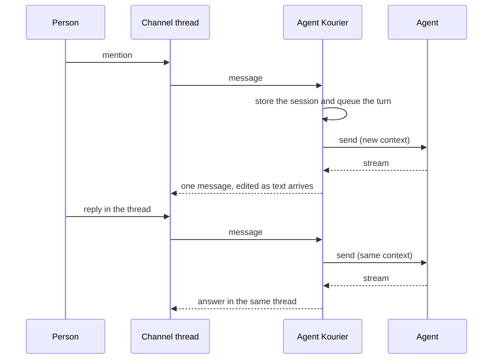

# Threads and sessions

This page explains how a chat thread becomes an agent session, and what happens to it as people reply, the agent
works, Agent Kourier restarts, and time passes.

## A thread is a session

Agent Kourier maps each thread to one A2A context. The conversation key is the connection, the channel and the
thread's root message; it maps to the agent's `contextId`. Every turn in the thread is sent into that context, so the
agent sees the whole conversation and nothing is re-explained.

The session row is written before the first call to the agent, and the context is filled in from the agent's first
response. A turn's message ID comes from the chat message itself, so the two events Slack delivers for one mention, and
a redelivery of either, are one turn.

## Who the agent hears from

Every turn runs as the Binding's service identity, whoever typed it. Agent Kourier puts the person's name and ID at the
start of the text they wrote. That prefix is informational, never authorization, and it is load-bearing: in kagent's
measured behaviour the agent's own earlier replies reach the model as user messages, so the prefix is what tells a person's message from the
agent's own output.

## Replies while the agent works

An agent runs one task per session at a time. A reply that arrives while a task runs is queued, marked with a
reaction, and sent when the task ends, in order, one per turn. A reply while the agent waits on a question is held the
same way, unless the question takes typed replies, in which case the first reply is its answer.

With `chat.threadReplies: mention`, only replies that mention Agent Kourier are turns, except a typed answer to the agent's pending question. The
others are ignored, and the next mentioned turn carries them to the agent as context, in a block marked as untrusted data.

## Output

With `output: live`, the answer streams into one message as the agent writes it; tool calls appear as short status
lines or step cards. A dropped stream is reconciled by asking the agent for the task and subscribing to it again. With
`output: final`, the answer is posted once, when the turn ends.

## Restarts

Agent Kourier persists sessions, queued replies, pending questions and intended posts. After a restart it finds the
tasks that were running, asks the agent for their state, and renders their output under the turn that started them, so
a half-written message is replaced with the whole answer and the thread finishes once.

## Lifetime

A thread keeps its session for `session.threadTTL`, 90 days by default, after its last activity, and a reply at any
point in that window resumes the same context. The agent platform suspends and resumes idle sessions on its own;
Agent Kourier has no idle timeout.

After the TTL, the thread has expired: a reply that the Binding would take gets a notice that the conversation has expired and that a new mention
starts a new one. 90 days after expiry the session is deleted with everything that belongs to it, and the thread
becomes one Agent Kourier never owned. If the agent reports that a session no longer exists, Agent Kourier says so in
the thread, and the next message starts a fresh context.

## Alerts

An alert thread is a session like any other, started by a trigger instead of a person. Repeats of the same alert attach
to the thread as notes, its resolve closes it with a note, and people continue the investigation by replying. The
first turn names no person; it is filed under the system user. See [Chat triggers](../reference/chat-triggers.md).
