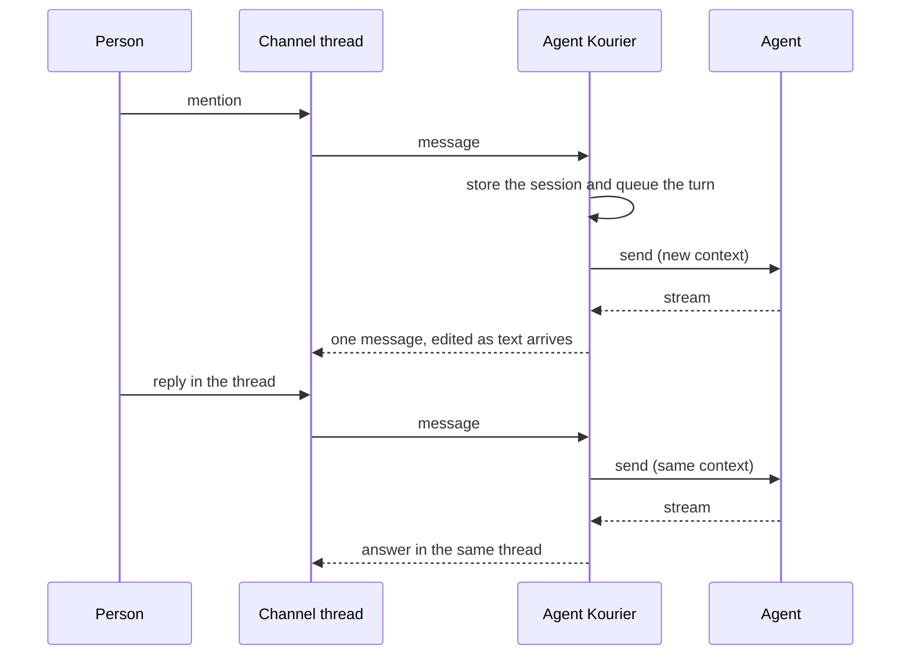

# Threads and sessions

This page explains how a chat thread becomes an agent session, and what happens to it as people reply, the agent
works, Agent Kourier restarts, and time passes.

## A thread is a session

Agent Kourier maps each thread to one A2A context. The conversation key is the connection, the channel and the
thread's root message; it maps to the agent's `contextId`. Every turn in the thread is sent into that context, so the
agent sees the whole conversation and nothing is re-explained.

The session row is written before the first call to the agent, and the context is filled in from the agent's first
response. A turn's message ID comes from the chat message itself, so the two events Slack delivers for one mention, and
a redelivery of either, are one turn.

## Who the agent hears from

Every turn runs as the Binding's service identity, whoever typed it. Agent Kourier puts the person's name and ID, behind a label that names the chat platform (`Slack:`), at the
start of the text they wrote. That prefix is informational, never authorization, and it is load-bearing: in kagent's
measured behaviour the agent's own earlier replies reach the model as user messages, so the prefix is what tells a person's message from the
agent's own output.

## Replies while the agent works

An agent runs one task per session at a time. A reply that arrives while a task runs is queued and sent when the task
ends, in order, one per turn. A reply while the agent waits on a question is held the
same way, unless the question takes typed replies, in which case the first reply is its answer.

By default, Agent Kourier adds an hourglass reaction to each accepted message. It stays while the message waits or the
agent processes it, and is removed when the turn ends or the agent asks a question and waits for an answer. A typed answer
gets its own reaction. Set `chat.acknowledgment.enabled: false` on the Binding to disable it, or set
`chat.acknowledgment.emoji` to another bare Slack reaction name such as `eyes`.

With `chat.threadReplies: mention`, only replies that mention Agent Kourier are turns, except a typed answer to the agent's pending question. The
others are ignored, and the next mentioned turn carries them to the agent as context, in a block marked as untrusted data.

## Output

With `output: live`, the answer streams into one message as the agent writes it. A dropped stream is reconciled by
asking the agent for the task and subscribing to it again. With `output: final`, the answer is posted once, when the turn
ends; nothing else is shown until then but the acknowledgment reaction, and `chat.progress` has no effect.

What a live reply shows of the agent's work depends on where the thread is and on `chat.progress`.

- **A chat thread** (a message someone sent, so Slack shows the stream to that person) shows a step card for each tool
  call, in the order the calls were made. The card begins when the call arrives and finishes when its result does. Every
  dialect reports the tool calls of an agent that marks them as Google ADK or kagent does; see
  [Tool calls and results](../reference/agent-contract.md#tool-calls-and-results).
- **An alert thread** has no one to show a stream to, so one message is updated instead. A line of small print names the
  latest tool call: `Calling name(arguments)` while it is under way, `Ran name(arguments)` once its result has arrived,
  and `name(arguments) failed` if the result reports a failure. A call that has its result is shown only while the message
  has no text yet, and the text replaces the line.

`chat.progress` adds a sign of life for the seconds when the agent says nothing, which is when a model is deciding its next
step. It is one of three values:

| `progress` | Chat thread | Alert thread |
|---|---|---|
| `steps` | A card for each tool call. | The line for the latest tool call. |
| `steps-and-activity` (the default) | The same, and when 3 seconds pass with no new text and no tool call under way, a card titled `Working…` begins. The next tool call takes that card over, so it carries the tool's name and arguments from then on; text instead retitles it `Wrote the answer`, and a tool call after that text retitles it `Wrote an update`. | The same, and `Working…` as a line of small print once 3 seconds pass with nothing new, in place of the line of a call that returned, until the next text or tool call. |
| `activity` | One card for the whole wait, begun at the first tool call or result, or after 3 seconds, and only before any text. Its title counts the tool calls that have a result, such as `Working… 12 steps, 3 failed`. At the first text it becomes `Worked`, with `Took 3 min 26 s, 16 steps (7 failed)`. | One line, `Working… (2 min, 12 steps, 3 failed)`, until the first text. |

The `activity` mode never shows a tool's name or arguments in the reply's cards and lines; a tool approval prompt, with
`interactions.toolApprovals`, still names the tool and shows its arguments. No mode shows the agent's reasoning: Agent Kourier does not read
it, and the `Working…` title says nothing about what the agent is doing. The 3 second delay is not configurable. The
`Working…` card or line is written once for a gap, and no other write follows the clock. A gap longer than the delay costs
at most three writes more than `steps` spends in a chat thread (the card's begin; its end, when no tool call takes it over;
and its retitle, when text ended it and a tool call follows that text), and one more message update in an alert thread. The `activity` card is written when a result changes a count, at most
once in a throttle window, and its line's elapsed minutes are refreshed only when an event makes a write.

In an alert thread, a turn that is silent for 3 seconds now posts `Working…` as its message. If the turn then ends with
nothing to show, or fails, that message is left saying `(no output)`; under `steps` such a turn posted nothing. A chat
thread whose stream was started for a card, and whose platform then refuses cards, is stopped with the same `(no output)`
when the turn ends empty, and is not left open.

A `Working…` card that no tool call took over ends under a title that says how, never as a tick on `Working…`. If text came
while it was open it is `Wrote the answer`, until a tool call follows that text: the text was then not the answer, and the
card is retitled `Wrote an update`. If the turn ends first, it is `Finished` for a completed task, `Waiting for your
answer` when the agent asks a question, and `Stopped`, shown as an error, when the task failed, was cancelled or was
rejected, or when the request failed before the task ended, as when the agent did not take an answer. The failure notice
is then a message of its own, and the reply's stream is stopped, not left running. A lost connection to the agent, or a
restart of Agent Kourier, is not such a failure: the task is followed again, and the reply it had is taken over and
updated, to `(no output)` if the task has nothing to show. Nor is a request that may have reached the agent but got no
answer, such as one cut off by a timeout: the reply stays as it is while the request is looked up and followed, or sent
again, and that attempt takes the reply over. If following the task again is refused, or finds it gone or wedged, or the
request is given up on before the agent is known to have it, the reply is ended as a failed request's is, and keeps the
text it had. When Agent Kourier restarts in between, the restarted process takes the reply over once it has something to
show or the task ends, but does not end it for those failures: the reply stays as the earlier process left it. The `activity` card ends the same way, as `Worked` for text or a
completed task, with the same `Waiting for your answer` and `Stopped`. A card that was never sent when a turn ends with no text is not sent at all.

A tool call's card that has no result when the turn ends is complete, with `No result was reported.` under it. When the
agent pauses for a [tool approval](../how-to/agent-questions.md#tool-approvals), the card of each call the approval is
about ends as `Approval requested: name`, complete, whatever the call reported before the pause (kagent reports such a
call with an error that asks for the confirmation). The prompt is a message of its own, and the reply after the decision
shows the call again with how it ended.

A Binding that sets no `progress` gets `steps-and-activity`, so a Binding written before the field existed now shows
`Working…` in a gap. Set `progress: steps` to keep the cards and lines alone.

On Slack, an alert thread in `steps-and-activity` or `activity` also gets Slack's assistant status, `is working…`. Agent
Kourier sets it when the turn starts, before the thread has any reply, and again after each write but the last, because a reply in the
thread may take it off. It clears it when the turn ends, whether the turn finished, failed, was cancelled or stopped to ask a
question. It adds no write of its own on a timer. A chat thread never sets it. If Slack answers that the app or workspace cannot use the method, Agent Kourier logs
that once at info level and sets no status on that connection until it restarts; any other error stops it for that turn only.
The replies are unaffected. In our testing the status reached only clients
that were open when it was set, so it adds to the `Working…` line and does not replace it
([Configure Slack](../how-to/configure-slack.md#what-the-app-is-allowed-to-do) has what was tested and which scope).

Every dialect reads tool calls the same way, so an agent on the generic `a2a` dialect that marks its tool parts as Google
ADK or kagent does (`adk_type`, `kagent_type` or `kagent.dev/a2a/part-type`) gets the same cards and lines. An agent that
marks none has no tool events: `steps` shows nothing until text, `steps-and-activity` shows a `Working…` card in each gap,
and `activity` shows its card with no step count. When the platform has no step cards, or Slack refuses them for a stream
(the stream is then plain text), no mode shows a card.

## Restarts

Agent Kourier persists sessions, queued replies, pending questions and intended posts. After a restart it finds the
tasks that were running, asks the agent for their state, and renders their output under the turn that started them, so
a half-written message is replaced with the whole answer and the thread finishes once. In a chat thread the replacement
keeps the cards the stream would show, before the text: each tool call's, or in the activity modes the `Working…` or
activity card, kept up to date while the task runs, and a call with no result by the end says
`No result was reported.`. The same holds when a reply's text changed after it was streamed and the message is
rewritten. If Slack refuses the cards, the message is written again without them.

## Lifetime

A thread keeps its session for `session.threadTTL`, 90 days by default, after its last activity, and a reply at any
point in that window resumes the same context. The agent platform suspends and resumes idle sessions on its own;
Agent Kourier has no idle timeout.

After the TTL, the thread has expired: a reply that the Binding would take gets a notice that the conversation has expired and that a new mention
starts a new one. 90 days after expiry the session is deleted with everything that belongs to it, and the thread
becomes one Agent Kourier never owned. If the agent reports that a session no longer exists, Agent Kourier says so in
the thread, and the next message starts a fresh context.

## Alerts

An alert thread is a session like any other, started by a trigger instead of a person. Repeats of the same alert attach
to the thread as notes, its resolve closes it with a note, and people continue the investigation by replying. The
first turn names no person; it is filed under the system user. See [Chat triggers](../reference/chat-triggers.md).
