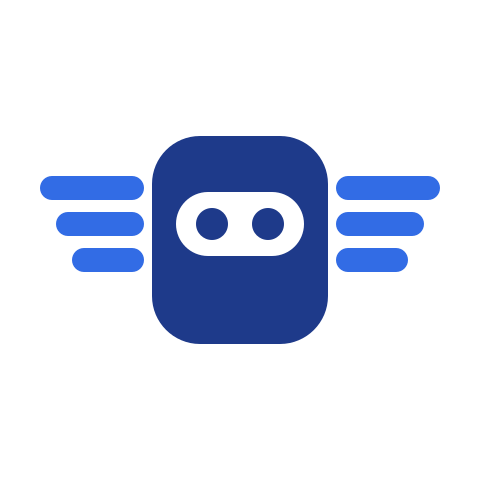
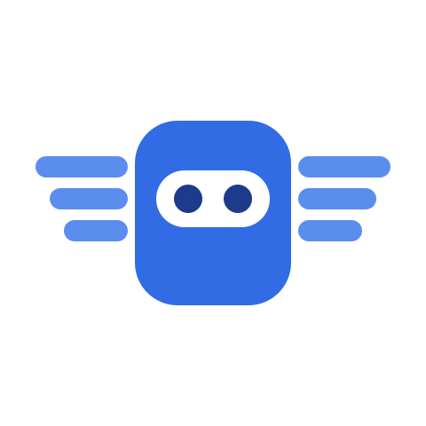

<h1 class="ak-hero__name">Agent Kourier</h1>

Write the agent, not the chat integration.

A Binding connects a chat channel to an agent that serves streaming A2A. Agent Kourier
handles the chat side: a session per thread, streamed replies, questions to people, investigations started by alerts,
and recovery after a restart or failover. Slack is supported today, and other chat platforms are planned.

<a class="md-button md-button--primary" href="tutorials/first-agent-in-slack/">Try it in a kind sandbox</a>
<a class="md-button" href="how-to/install-with-helm/">Install with Helm</a>

Chat

Slack

Agents

A2A
kagent
Google AX

!!! note "Status: v0.1.5"
    The current release is `0.1.5`: install the published chart and image with [Install with Helm](how-to/install-with-helm.md).
    The `v1alpha1` resource format can change before 1.0.

## What Agent Kourier handles

Without a broker, every agent that talks to chat needs its own code for threads, streaming, questions, restarts and
alerts. Agent Kourier does that work once for every agent you bind. It keeps a session per thread, queues replies that
arrive while the agent works, streams the answer into one message, posts the agent's questions in the thread, recovers
each conversation after a restart, and holds the thread while a suspended agent is not running. The agent keeps its
tools and task logic.

The platform team runs Agent Kourier and owns the chat app and the agent backends. Each application team connects its
own agent to its own channel with a namespaced Binding, committed next to the agent's manifests.
[Why a broker](explanation/why-a-broker.md) explains the split.

<figure class="ak-film">
<video controls preload="none" playsinline poster="assets/film/agent-kourier-teaser-poster-16x9.jpg" aria-label="Agent Kourier teaser, 20 seconds, narrated">
<source src="https://media.agentkourier.dev/agent-kourier-teaser-16x9.787d2408faec.mp4" type="video/mp4">
<track kind="captions" src="assets/film/agent-kourier-teaser.en.vtt" srclang="en" label="English" default>
<a href="https://media.agentkourier.dev/agent-kourier-teaser-16x9.787d2408faec.mp4">Download the teaser (MP4, 20 seconds)</a>.
</video>
<figcaption>The teaser, 20 seconds, narrated with captions. <a href="demo/">Watch the full demo</a> (98 seconds), or <a href="demo/#a-cross-team-incident">a cross-team incident</a> (3 minutes).</figcaption>
</figure>

-   :material-play-circle-outline:{ .lg } **Try it**

    ---

    Run Agent Kourier in a kind cluster against your own Slack workspace and a read-only kagent agent, and get your
    first answer in a thread.

    [:octicons-arrow-right-24: Your first agent in Slack](tutorials/first-agent-in-slack.md)

-   :material-kubernetes:{ .lg } **Install**

    ---

    Install the Helm chart on a cluster you already run, connect Slack, and bind your first agent to a channel.

    [:octicons-arrow-right-24: Install with Helm](how-to/install-with-helm.md)

-   :material-transit-connection-variant:{ .lg } **How it works**

    ---

    One broker between your chat and your agents: a thread is a session, conversations resume after a restart, and
    [two replicas on Postgres](explanation/high-availability.md) fail over. The [delivery](explanation/delivery.md) and
    failover pages say what a restart or failover can still repeat.

    [:octicons-arrow-right-24: Architecture](explanation/architecture.md)

## A thread is a session

An alert lands in the channel. Agent Kourier opens a thread under it and hands it to the agent, which investigates and
answers there. People reply in the same thread and the same agent session continues.

#payments-alerts

Alertmanager
FIRING (1) - PaymentsApiErrorRate

Agent Kourier
The 5xx rate rose at 14:02, two minutes after the 14:00 rollout of payments-api. The new pods fail their
readiness probe and restart. The last crash log ends with "pool size must be &gt;= 5".

Engineer
what changed in that rollout?

Agent Kourier
The ConfigMap payments-api-env changed DB_POOL_SIZE from 20 to 2. Nothing else in the Deployment differs from the
previous revision.

An illustration of one alert thread, not captured output. The answers come from your agent;
Agent Kourier carries them.

A repeat of the same alert attaches to its thread, and its resolve posts a note there. Agent Kourier reads the alert
your alerting tool already posts to Slack, so your alerts arrive as before, whether or not Agent Kourier is running.
The docs have a [worked trigger for Alertmanager](how-to/investigate-alertmanager-alerts.md);
[another tool's bot](how-to/any-bot-trigger.md) needs a trigger of its own.
