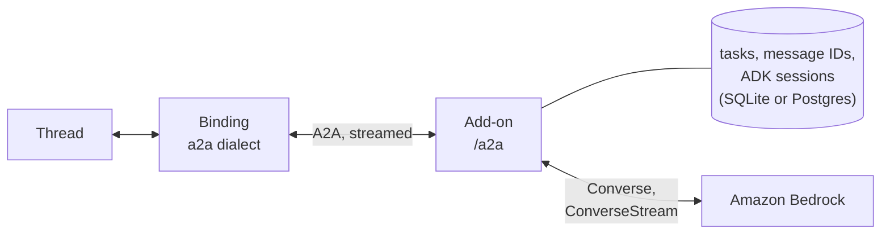
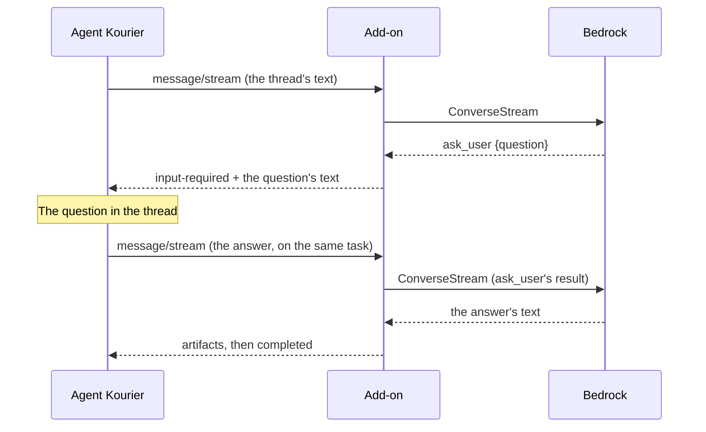

# AX add-on

The AX add-on is an agent: an ADK agent on Amazon Bedrock that serves A2A, with one tool, `ask_user`, whose question a
person answers in the thread. Agent Kourier reaches it through an AgentBackend with the `a2a` dialect. The chart runs it
beside Agent Kourier; it can also run inside Google AX as a Task, which is where its name comes from. It is
experimental. [Connect the AX add-on](../how-to/connect-ax.md) installs it either way; [Add-ons](../explanation/add-ons.md)
says what an add-on is.

Agent Kourier owns the chat side: the thread, its session, the question's prompt and its timeout, and audit. The add-on
is the agent: it runs each turn through ADK, with Bedrock as the model, and keeps the ADK session of each thread.

The agent answers chat messages and investigates the alert text it is given. It has no tool that reaches another system,
so it works from what the thread's messages carry, and asks with `ask_user` for what is missing. It is a starting point
for an agent of your own as much as an agent to run.

## How A2A maps to ADK

| A2A (what Agent Kourier sees) | ADK (what the add-on does) |
|---|---|
| A context (one thread) | One ADK session, whose ID is the context ID and whose user is the caller ([Caller check](#caller-check)), created on the context's first message. |
| A task | One turn of the ADK runner on that session. ADK's A2A executor streams the agent's output as artifacts. |
| `input-required`, with the question as the status message's text | The agent calls `ask_user`, a long-running tool. The add-on puts the call's `question` in the status message as text, and keeps the call in the task's metadata, `agentkourier.dev/ask-user`, so that a restart does not lose it. |
| The next message on the paused task | The answer: the message's text parts joined with newlines, sent to ADK as `ask_user`'s result, `{"answer": "<text>"}`. A message with a part that is not text, or with no text, fails the task. |
| Cancel | ADK cancels the turn, and the task is canceled. |
| `completed` | The turn ended. |
| `failed` | The model call failed; the agent paused on two `ask_user` calls at once; the answer was not text; or a restart cut the turn off ([Restarts](#restarts)). |

The question reaches Agent Kourier as plain text, which the `a2a` dialect reads as a question when the Binding has
`interactions.askUser: true`; without it, Agent Kourier cancels the task and says so in the thread
([Let the agent ask questions](../how-to/agent-questions.md)). A person answers by replying in the thread or with the
answer form. The `ask_user` call shows no step card: the add-on replaces the call in the status message with its text.

The agent card, at `/a2a/.well-known/agent-card.json`, names the endpoint `PUBLIC_URL` and the add-on's version, and
advertises streaming over JSON-RPC and text input and output. It lists no extension, so Agent Kourier never reads a pause
of the add-on as a tool approval. Unlike the card of the [Claude Managed Agents add-on](claude-managed-agents.md), it is
behind the caller check: Agent Kourier fetches it with the Binding's token.

## A turn with a question

The paused task waits in the store, so the answer may come after a restart of the add-on or of Agent Kourier. If nobody
answers before the Binding's `interactions.timeout`, Agent Kourier ends the pause as its
[agent contract](agent-contract.md#structured-questions-and-tool-approvals) says.

## Restarts

The store keeps the A2A tasks, the message ID that started or joined each task, when each context was last active, and
the ADK sessions with their events, so a restart loses none of them. At start, before it listens, the add-on:

1. Opens the store and applies its migrations and ADK's. On SQLite it also imports the tasks of a file in the layout of
   the agent before it was an add-on ([Store](#store)).
2. Fails each task left `submitted` or `working` with the agent message "Interrupted by an agent restart.".

| Survives a restart | Is interrupted |
|---|---|
| A task paused on a question (`input-required`): an answer after the restart resumes it | A turn that was running: its task fails, and Agent Kourier shows its fixed failure notice in the thread. The model call is not made again. |
| Each context's ADK session: the thread's next turn continues it | |
| The record of message IDs: a resend joins its first send's task | |

Agent Kourier sends a message again, with the same ID, when it cannot tell whether the first send arrived. A message
whose ID the store has recorded for the same caller joins that message's task instead of starting a second turn: it gets
the task as it stands if the task has settled or paused, and the rest of its stream otherwise. A resend that names
another context or task than the first send's is refused as invalid.

## Sessions and their lifetime

A context is active when one of its tasks is created or updated, and when a message for it arrives, before the message is
accepted. `SESSION_IDLE_TTL` deletes a context once it has been inactive for that long with no turn running, checked
once a minute: its ADK session and the session's events, its tasks, a question it waits on included, and their message
IDs. The context's next message starts a new session without the old history.

Set it to the Binding's `session.threadTTL`, whose default, `2160h`, is the add-on's default too. Past that, Agent
Kourier gives the thread a new context and never uses the old one again. A shorter value deletes sessions a thread can
still continue, and the questions they wait on.

`TASK_RETENTION` deletes a settled task (completed, failed, canceled or rejected), with its message IDs, once its last
update is older than that, checked once a minute. A sweep that fails is logged and tried again at the next one.

## Store

**SQLite** (`STORE=sqlite`, the default) is one file, `SQLITE_PATH`, whose directory the add-on creates if it is
missing. The add-on holds an exclusive lock on the file `SQLITE_PATH` plus `.lock` while it runs, so a second agent on the
same file stops at start ("another agent has the SQLite file open"); the lock is the kernel's, so it goes with a process
that dies. The file is in WAL mode, with FULL synchronous commits and a busy timeout of 5 seconds. The add-on's writes and
ADK's go through one connection, and its reads through a pool of four beside it. Copy the file with its `-wal` file,
which holds commits not yet written into it.

Before it was an add-on, the agent took a directory, `STATE_DIR`, and kept its tasks in a layout of its own beside ADK's
tables. The add-on does not start while `STATE_DIR` is set: set `SQLITE_PATH` to the file in it (`STATE_DIR` plus
`/agent.db`) instead. At the first start on such a file, it imports the old tasks and their message IDs, so a question
that waited across the upgrade can still be answered; ADK's tables carry over as they are.

**Postgres** (`STORE=postgres`) is shared by the replicas ([Replicas](#replicas)). Replicas that start together apply each
migration, and ADK's, once, under an advisory lock of the add-on's own. Each connection starts with
`idle_in_transaction_session_timeout` of 10 seconds and `statement_timeout` of 30 seconds, unless the DSN sets them. Give
the add-on a database of its own, apart from Agent Kourier's and other add-ons'.

ADK's own writes and the add-on's run the same check first, in the same transaction: on Postgres, that this replica
still holds the leader's lease, so a leader that has lost it cannot write.

## Replicas

**SQLite** is one replica. The chart refuses `addons.ax.replicaCount` above 1 with SQLite, puts the file on a
ReadWriteOnce volume, and replaces the pod with the Recreate strategy, so the old pod has released the volume before the
new one starts. The add-on refuses `LEASE_DURATION`, `LEASE_RENEW_DEADLINE` and `LEASE_RETRY_PERIOD` with SQLite.

**Postgres** runs several replicas. The chart gives them a rolling update that starts a new pod before it takes an old
one away, and at 2 replicas and more a PodDisruptionBudget with `maxUnavailable: 1`.

The replicas elect a leader through a lease row in the add-on's database, not a Kubernetes Lease, so the add-on needs
no RBAC. The leader serves A2A, and every write it makes checks the lease's epoch in the same transaction. A standby
forwards each A2A request and the agent card to the leader's `ADVERTISE_URL`, streaming the answer through unbuffered; the
caller check runs on the leader. The add-on answers 503 with `Retry-After` (the election's retry period, at least 1
second) on a leader that has not finished taking over, on a standby that knows of no leader or cannot reach it, and on a
replica that is not serving when the request was already forwarded once: a request is forwarded once at most. A leader
that cannot renew the lease for `LEASE_RENEW_DEADLINE` exits, and one that stops on SIGTERM releases the lease. A replica
fails the turns a restart cut off only once it holds the lease, so two replicas never fail each other's turns, and a
replica that takes over runs the same start-up work as a restart: a turn that was running on the old leader fails, and a
paused question survives.

## Caller check

Every request to `/a2a` and to the agent card must pass the caller check. The add-on does not start unless exactly one
check is set: the token file, OIDC, or none with `AUTH_DISABLED=true` on a loopback address.

- **The token file** (`AUTH_TOKEN_FILE`), the chart's check. A request must carry one of the file's tokens.
    - **The header.** With `AUTH_HEADER` unset, the token comes as `Authorization: Bearer <token>` (the scheme in any
      case), which is what a Binding's `identity.tokenSecretRef` sends. With another header name, the header's whole
      value is the token, which an AgentBackend `headers` entry with a `valueSecretRef` sends. The add-on does not
      start, and the chart's values schema refuses `addons.ax.auth.header`, when the name is one of the other headers
      Agent Kourier reserves for the Binding's identity, in any case: `Proxy-Authorization`, `Cookie`, `X-User-Id`,
      `X-Agent-Name`, `X-Share-Token` or `X-Kagent-Insecure-Runtime-Identity`.
    - **The file.** One token per line. Lines that are blank or start with `#` are skipped, and trailing whitespace (a
      CR included) is stripped. The add-on does not start with a file it cannot read or that holds no token. It reads
      the file again every 5 seconds, because a mounted Secret changes by swapping a symlink; a read that fails or finds
      no token keeps the last good tokens, and is logged once until the failure changes.
    - **The comparison.** The add-on keeps only each token's SHA-256 and compares the digest of the presented token
      with every one in constant time.
- **OIDC** (`OIDC_ISSUER`, `OIDC_AUDIENCE` and `OIDC_SUBJECT`, all three), the check for the route inside Google AX.
  A request's `Authorization` must carry one `Bearer` ID token, signed by the issuer's keys, for the audience, whose
  subject is `OIDC_SUBJECT`. `AUTH_HEADER` must be unset or `Authorization`. The add-on reads the issuer's discovery
  document at the first request that carries a token, not at start, so that building an AX golden snapshot needs no
  egress to the issuer. When the issuer or its keys cannot be reached, the request is answered 503 with
  `Retry-After: 1`, not 401.
- **Off.** `AUTH_DISABLED=true` turns the check off, and is refused unless `LISTEN_ADDR` is a loopback address
  (`127.0.0.0/8`, `::1` or `localhost`) and neither of the other checks is set. The chart has the add-on listen on every
  interface of its pod and never sets it.

A request the check refuses gets 401 (with `WWW-Authenticate: Bearer` when the token comes in `Authorization`), or the
503 above, and the add-on logs `refused an A2A request` with the reason `missing`, `invalid` or `unavailable`, never the
value it was given. `/healthz`, `/readyz` and `/metrics` need no token.

**Tasks are kept apart by caller.** The caller a request passes as owns the tasks it creates and is the user of their
ADK sessions, and every read and write made for a request is limited to its caller's tasks: another caller's task is not
found, and cannot be followed while it runs. With the token file every accepted token is the same caller, so the tokens
exist to be rotated, not to tell callers apart. With OIDC the caller is the token's subject.

## Endpoints

All on one port: 8090 in the chart, named `http` on the Service, and 80 in the route inside Google AX.

| Path | What it serves |
|---|---|
| `/a2a` | A2A JSON-RPC, behind the caller check |
| `/a2a/.well-known/agent-card.json` | The agent card, behind the caller check |
| `/healthz` | 200 once the add-on listens: the process is alive. The chart's liveness probe asks it. |
| `/readyz` | With `RUNNER_URL` unset, 200 once the add-on serves, which on a leader is only after its start-up work, until it starts to stop. The chart's startup and readiness probes ask it. With `RUNNER_URL` set, the AX task runner's, proxied to it. |
| `/metadata/` | With `RUNNER_URL` set only: the AX task runner's metadata server, proxied to it |
| `/metrics` | Prometheus metrics |

On Postgres, `/readyz` answers 200 on a standby too, since a standby forwards to the leader, so every replica is behind
the Service. The binary prints its version with `--version` and takes no other argument.

## Settings

The add-on reads its settings from its environment, and an empty value is an unset one. A setting it cannot use stops it
at start with an error that names the variable; the error never shows the value of `POSTGRES_DSN`, `AUTH_HEADER`,
`OIDC_ISSUER` or `RUNNER_URL`. Every duration is a Go duration, such as `90s` or `720h`, of zero or more unless the row
says otherwise.

| Variable | Default | What it does | Chart value |
|---|---|---|---|
| `MODEL_PROVIDER` | `bedrock` | The model's provider. Bedrock is the only one. | `addons.ax.model.provider` |
| `MODEL_REGION` | Required | The AWS region the add-on calls Bedrock in. | `addons.ax.model.region` |
| `MODEL_NAME` | Required | The Bedrock model ID or inference profile. | `addons.ax.model.name` |
| `AWS_BEARER_TOKEN_BEDROCK` | None | A Bedrock API key, which the AWS SDK reads. Without it, the SDK's default chain finds AWS credentials: access keys in the environment, a profile, a web identity (IRSA), EKS Pod Identity, or the instance's role. | `addons.ax.bedrock.apiKeySecret`; IRSA through `addons.ax.serviceAccount.annotations` |
| `LISTEN_ADDR` | `127.0.0.1:8090` | Where the add-on listens, as `host:port`. | Always `:8090` |
| `PUBLIC_URL` | `http://` + `LISTEN_ADDR` + `/a2a` | The endpoint the agent card names: the URL Agent Kourier reaches. An `http` or `https` URL with a host. | Always `http://<fullname>-ax.<namespace>.svc:8090/a2a` |
| `RUNNER_URL` | None | The AX task runner's metadata server, an `http` or `https` origin, to which `/readyz` and `/metadata/` are proxied. Unset, the add-on runs standalone and answers `/readyz` itself. | Never set |
| `AUTH_TOKEN_FILE` | None | The file of accepted tokens. One caller check is required: this, OIDC, or `AUTH_DISABLED`. | Always `/etc/agent-kourier-ax/auth/tokens`, the key of `addons.ax.auth.tokenSecret` |
| `AUTH_HEADER` | `Authorization` | The header that carries the token. Must be a header name, and not one of the reserved names in [Caller check](#caller-check); with OIDC, `Authorization` only. | `addons.ax.auth.header` |
| `OIDC_ISSUER`, `OIDC_AUDIENCE`, `OIDC_SUBJECT` | None | The OIDC check: all three or none. The issuer is an `http` or `https` URL with a host and no user info, query or fragment. | Never set |
| `AUTH_DISABLED` | `false` | `true` turns the caller check off, on a loopback `LISTEN_ADDR` only. | Never set |
| `STORE` | `sqlite` | `sqlite` or `postgres`. | `addons.ax.store.type` |
| `SQLITE_PATH` | `ax-addon.db` | The SQLite file, with `STORE=sqlite`. | Always `/data/ax.db`, on the claim `<fullname>-ax-data` or `addons.ax.persistence.existingClaim` |
| `POSTGRES_DSN` | Required with `postgres` | The connection string, as pgx reads it. Refused with `STORE=sqlite`. | `addons.ax.store.postgres.dsnSecret` |
| `TASK_RETENTION` | `720h`<!--addon-limit:ax.task-retention--> | How long a settled task and its message IDs are kept after its last update. `0` keeps them. | `addons.ax.taskRetention` |
| `SESSION_IDLE_TTL` | `2160h`<!--addon-limit:ax.session-idle-ttl--> | How long a context may go inactive before its ADK session and its tasks are deleted. `0` keeps them. | `addons.ax.sessionIdleTTL` |
| `LEASE_DURATION` | `15s`<!--addon-limit:ax.lease-duration--> | Postgres only, more than zero, and longer than the renew deadline. How long a lease lasts without renewal. | `addons.ax.leaderElection.leaseDuration` |
| `LEASE_RENEW_DEADLINE` | `10s`<!--addon-limit:ax.lease-renew-deadline--> | Postgres only, more than zero, and longer than `1.2`<!--addon-limit:ax.lease-jitter--> times the retry period. How long the leader keeps trying to renew. | `addons.ax.leaderElection.renewDeadline` |
| `LEASE_RETRY_PERIOD` | `2s`<!--addon-limit:ax.lease-retry-period--> | Postgres only, more than zero. How often a replica tries to take or renew the lease. | `addons.ax.leaderElection.retryPeriod` |
| `ADVERTISE_URL` | Required with `postgres` | An `http` or `https` URL with a host, where the other replicas reach this one. An IPv6 address without brackets is given them. | Always `http://$(POD_IP):8090`, from the downward API |
| `POD_NAME` | The hostname | This replica's name as a lease holder. | The pod's name, with Postgres |
| `LOG_LEVEL` | `info` | `debug`, `info`, `warn` or `error`. Logs are JSON on standard error. | `addons.ax.logLevel` |
| `STATE_DIR` | None | No longer read: the add-on does not start while it is set. Set `SQLITE_PATH` instead. | Never set |

The OpenTelemetry variables are the ones Agent Kourier reads (`OTEL_SERVICE_NAME`, `OTEL_TRACES_EXPORTER`,
`OTEL_EXPORTER_OTLP_ENDPOINT` and the rest; see [Logs and traces](logs-and-traces.md)), with the service name
`agent-kourier-ax` by default. The chart passes them, and the AWS SDK's other variables, through `addons.ax.extraEnv`.

In the route inside Google AX, `addons/ax/task.yaml` sets `LISTEN_ADDR=:80`, `RUNNER_URL=http://127.0.0.1:8081`,
`SQLITE_PATH=/workspace/agent-kourier-state/agent.db`, the three `OIDC_*` variables, and a placeholder
`AWS_BEARER_TOKEN_BEDROCK` that the egress gateway replaces with the real key.

## Telemetry

The add-on logs JSON lines on standard error at `LOG_LEVEL`. It never logs a token it was sent.

Metrics are on `/metrics`, with the prefix `agentkourier_ax_`. With `serviceMonitor.enabled` the chart adds a
ServiceMonitor of the add-on's own.

| Metric | Type | What it counts |
|---|---|---|
| `agentkourier_ax_turns_total{outcome}` | Counter | Turns, by how they ended |
| `agentkourier_ax_operation_duration_seconds{operation,outcome}` | Histogram | Calls to Bedrock |
| `agentkourier_ax_auth_refused_total{reason}` | Counter | Requests the caller check refused, by `missing`, `invalid` or `unavailable` |
| `agentkourier_ax_message_replays_total` | Counter | Resent messages that joined their first send's task |
| `agentkourier_ax_tasks_interrupted_total` | Counter | Tasks a restart or takeover failed |
| `agentkourier_ax_sessions_deleted_total{reason}` | Counter | ADK sessions deleted |
| `agentkourier_ax_leader` | Gauge | 1 on the leader, 0 elsewhere |
| `agentkourier_ax_leader_takeovers_total` | Counter | Times this replica became the leader |
| `agentkourier_ax_forwarded_requests_total{outcome}` | Counter | Requests a standby forwarded to the leader |

Each turn is a span, `agentkourier.ax.turn`, a child of the trace context Agent Kourier sends with the request, and
each call to Bedrock a span `agentkourier.ax.model.<operation>` under it.

## Limits

[Limits](limits.md#ax-add-on) has every limit of the add-on with its value. In short:

- **Text only.** Questions go out as text, and answers come back as text.
- **One tool.** The agent has `ask_user` and nothing that reaches another system, and asks for no tool approval.
- **Bedrock only.**
- **A restart fails the turns in flight**, and keeps paused questions.
- **An idle context loses its questions.** `SESSION_IDLE_TTL` deletes a question it waits on with the rest.
- **One replica on SQLite.**
- **IRSA and EKS Pod Identity are untested.** The chart's routes to Bedrock through an IAM role have not been run on EKS.
