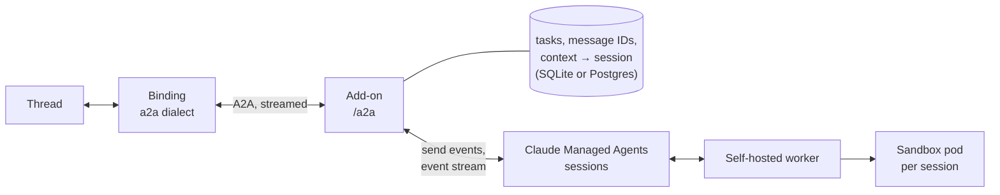
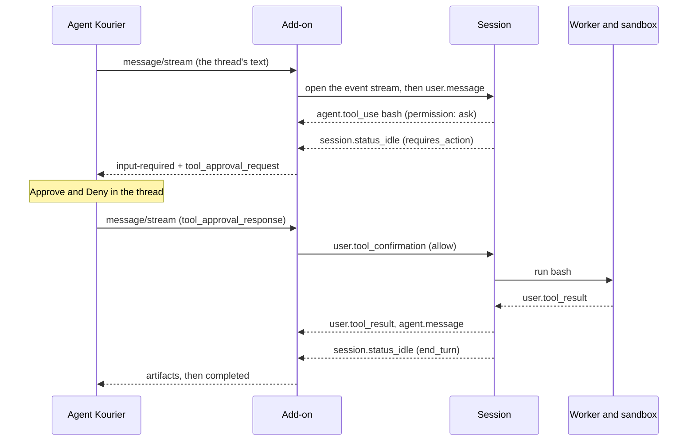

# Claude Managed Agents add-on

The Claude Managed Agents add-on is an A2A server in front of one agent in Claude Managed Agents. Agent Kourier reaches
it through an AgentBackend with the `a2a` dialect, and it turns each A2A turn into a turn of a session of the agent,
through the Anthropic API. It is experimental: it was tested against a self-hosted environment with a Haiku agent, and
cloud environments are untested. [Connect Claude Managed Agents](../how-to/connect-claude-managed-agents.md) installs
it; [Add-ons](../explanation/add-ons.md) says what an add-on is.

Agent Kourier owns the chat side: the thread, its session, approvals and their timeout, and audit. The add-on
translates. Claude Managed Agents owns the agent: the model loop, its tools and the sandbox they run in.

## How A2A maps to sessions and turns

| A2A (what Agent Kourier sees) | Claude Managed Agents (what the add-on does) |
|---|---|
| A context (one thread) | One session of the agent, created on the context's first message, with the context ID in its `a2a_context_id` metadata and the title `A2A context <id>`. Sessions run the agent's latest version in the configured environment. |
| A task | One turn of that session. |
| A message's text and data parts | One `user.message`. Data parts are sent as JSON text, and the parts are joined with newlines. A message with any other part, or with no text, is refused as invalid. |
| Artifact text | `agent.message` text. Content blocks that are not text are not shown. |
| ADK `function_call` and `function_response` data parts, which Agent Kourier renders as tool calls | `agent.tool_use` and `agent.mcp_tool_use`, and their results (`agent.tool_result`, `user.tool_result`, `agent.mcp_tool_result`). A result's text is cut to 4000 characters and marked with `…`. |
| `input-required` with kagent's human-in-the-loop `tool_approval_request` | A tool call whose evaluated permission is `ask` (the `always_ask` policy), once the session idles with `requires_action` on it. |
| `tool_approval_response` | One `user.tool_confirmation` per call. A denial passes its reason on as the deny message. |
| Cancel | `user.interrupt`, and the task is canceled. |
| `completed` | The session idles with the stop reason `end_turn`. |
| `failed` | The session terminates; idles with any other stop reason; idles on a call the turn cannot answer (below); its event stream ends before the turn does; or a sandbox tool gets no event in time. |

The agent card, at `/a2a/.well-known/agent-card.json`, names the endpoint `PUBLIC_URL`, advertises streaming over
JSON-RPC and text input and output, and lists the human-in-the-loop extension, `https://kagent.dev/extensions/hitl/v1`,
which is how Agent Kourier's `a2a` dialect knows to read the add-on's pauses as tool approvals.

## A turn with an approval

The add-on opens the session's event stream before it sends anything, because the stream delivers only the events
that happen after it opens.

An answer to a paused task must decide every call the pause named, once each, in a `tool_approval_response`. The add-on
refuses any other answer as invalid before the turn runs, a typed reply in the thread included, and the task stays
paused. Agent Kourier sends one from the Approve and Deny buttons; if nobody decides before the Binding's
`interactions.timeout`, it denies the calls ([Agent contract](agent-contract.md#structured-questions-and-tool-approvals)).

On a self-hosted environment, a built-in tool's result comes from the worker as `user.tool_result`, and a call the agent
may run without asking also idles the session with `requires_action` until that result arrives. The add-on treats both
as waits, not as questions: a pause asks only about the calls whose permission was `ask`. A pause on anything else, such
as a custom tool, or a call the turn did not see ask for approval, fails the turn with "The agent is waiting on an
action this adapter cannot answer."

## A sandbox that never starts

A self-hosted sandbox that cannot be scheduled sends no event at all, and the session waits. When a turn waits on a
built-in tool that the sandbox runs (one the agent may run, or one a person approved) and no session event arrives for
`TOOL_RESULT_TIMEOUT`, the add-on sends the session `user.interrupt` and fails the task with the status metadata
`code: timeout`, which selects Agent Kourier's timeout notice in the thread. A tool that runs silently for longer is
cut off the same way. MCP tools do not run in the sandbox, and a model that is thinking is not waiting on a tool, so
neither is timed.

The add-on also sends a `working` update after every 60 seconds without a session event, so that Agent Kourier, which
cuts a stream silent for 5 minutes, keeps a slow turn's stream open.

## Restarts

The store keeps the A2A tasks, the message ID that started or joined each task, and each context's session, so a
restart loses none of them. Its migrations are applied at start.

A store that an earlier version of the add-on wrote, which kept each context's session in a table of its own, is
refused: the add-on logs that the store holds an earlier layout and exits with code 1, before it writes to the store.
Start the add-on on a new store: a new SQLite file, or an empty Postgres database or schema. The chart reuses the claim
`<fullname>-cma-data` while it exists, so for SQLite set `addons.cma.persistence.existingClaim` to a new claim of your
own, or delete that claim so that the chart makes a new one.

At start, before it serves, the add-on:

1. Loads each context's session from the store and checks it against the agent's unarchived, unterminated sessions in
   the environment that carry a context ID. It does not start if either cannot be read.
    - A stored session that is still listed is kept, and the context's other listed sessions are archived.
    - A context the store lacks adopts the session listed for it (the one active last, when there are several; the
      others are archived).
    - A stored session that is no longer listed (archived, terminated, or in another environment) is forgotten with
      its context's tasks, and the context's next message starts a new session.
2. Fails each task left `submitted` or `working` with the agent message "Interrupted by an adapter restart." and sends
   its session `user.interrupt` (a failed interrupt is logged). Each task is failed in a write of its own. A task whose
   stored record does not decode is failed by its state alone, so that `TASK_RETENTION` deletes it, and is logged at
   WARN; a task that changed since it was read is logged at WARN and left as it is. It does not start if the store
   cannot be read or written.

| Survives a restart | Is interrupted |
|---|---|
| A task paused on an approval (`input-required`): an Approve or Deny pressed after the restart reaches the paused calls | A turn that was running: its task fails, its session is interrupted, and Agent Kourier shows its fixed failure notice in the thread |
| Each context's session: the thread's next turn continues it | |
| The record of message IDs: a resend joins its first send's task | |

Agent Kourier sends a message again, with the same ID, when it cannot tell whether the first send arrived. A message
whose ID the store has recorded joins that message's task instead of starting a second turn: it gets the task as it
stands if the task has settled or paused, and the rest of its stream otherwise. A resend that arrives before the first
send's turn has answered anything waits for it, even when the first sender has hung up, so the message reaches the
session once. A resend that names another context or another task than its first send's is refused as invalid.

## Sessions and their lifetime

A session holds its sandbox until it is archived. `SESSION_IDLE_TTL` archives a context's session once the context
has had no message and no turn running for that long, checked once a minute, and deletes the context's tasks from
before the archive with their message IDs. The store keeps when each context was last active (a message for it
arrived, or a turn of it started or ended), so the clock survives a restart and a takeover. Archiving cannot be undone:
the context's next message starts a new session without the old history. A session that fails to archive is logged at
WARN and tried again at the next check; one whose context started a turn after the check listed it is kept.

Set it to the Binding's `session.threadTTL`, whose default, `2160h`, is the add-on's default too. Past that, Agent
Kourier gives the thread a new context and never uses the old session again. A shorter value archives sessions a thread
can still continue. `SESSION_IDLE_TTL` does not free an idle sandbox's memory; the environment's own idle timeout does.

`TASK_RETENTION` deletes a settled task (completed, failed, canceled or rejected), with its message IDs, once its last
update is older than that, checked once a minute.

## Replicas

**SQLite** (the default) is one replica. The add-on holds an exclusive lock on the file `SQLITE_PATH` plus `.lock` while
it runs, so a second add-on on the same file stops at start ("another adapter has the SQLite file open"). The chart
refuses `addons.cma.replicaCount` above 1 with SQLite, puts the file on a ReadWriteOnce volume, and replaces the pod with
the Recreate strategy, so the old pod has released the volume before the new one starts. The add-on refuses
`LEASE_DURATION`, `LEASE_RENEW_DEADLINE` and `LEASE_RETRY_PERIOD` with SQLite.

**Postgres** runs several replicas. Replicas that start together apply each migration once, under an advisory lock. The
chart gives them a rolling update that starts a new pod before it takes an old one away, and at 2 replicas and more a
PodDisruptionBudget with `maxUnavailable: 1`.

The replicas elect a leader through a lease row in the add-on's database, not a Kubernetes Lease, so the add-on needs
no RBAC. The leader serves A2A, and every write it makes checks the lease's epoch in the same transaction, so a leader
that has lost the lease cannot write. A standby forwards each A2A request and the agent card to the leader's
`ADVERTISE_URL`, streaming the answer through unbuffered; the caller check runs on the leader. The add-on answers 503 with `Retry-After` (the
election's retry period, at least 1 second) on a leader that has not finished taking over, on a standby that knows of
no leader or cannot reach it, and on a replica that is not serving when the request was already forwarded once: a
request is forwarded once at most. A leader that cannot
renew the lease for `LEASE_RENEW_DEADLINE`, or whose renewal or write finds that another replica has taken it, exits at
once with code 5, without a drain, and Kubernetes restarts it. One that stops on SIGTERM drains its requests for at most
5 seconds, then cancels the turns still running and waits at most 5 seconds for them, leaving their tasks for the next
leader to fail, then hands the lease over, for at most 3 seconds; past that, a standby takes over once the lease has run
out. A replica that takes over runs the same start-up work as a restart, so a turn that was running on the old leader
fails, and a paused approval survives.

## Caller check

A request to `/a2a` or to the agent card must carry one of the tokens in `AUTH_TOKEN_FILE`, or the add-on answers 401
(with `WWW-Authenticate: Bearer` when the header is `Authorization`) and logs `refused an A2A request` with the reason
`missing` or `invalid`, never the value it was given. Agent Kourier sends the token when it fetches the card, as with
every request to the endpoint. `/healthz`, `/readyz` and `/metrics` need no token.

- **The header.** With `AUTH_HEADER` unset, the token comes as `Authorization: Bearer <token>` (the scheme in any case),
  which is what a Binding's `identity.tokenSecretRef` sends. With another header name, the header's whole value is the
  token, which an AgentBackend `headers` entry with a `valueSecretRef` sends. The add-on does not start, and the chart's
  values schema refuses `addons.cma.auth.header`, when the name is one of the other headers Agent Kourier reserves for
  the Binding's identity, in any case: `Proxy-Authorization`, `Cookie`, `X-User-Id`, `X-Agent-Name`, `X-Share-Token`
  or `X-Kagent-Insecure-Runtime-Identity`. An AgentBackend may not set them, so none of them would ever carry the token.
- **The file.** One token per line. Lines that are blank or start with `#` are skipped, and trailing whitespace (a CR
  included) is stripped. The add-on does not start with a file it cannot read or that holds no token. It reads the file
  again every 5 seconds, because a mounted Secret changes by swapping a symlink; a read that fails or finds no token
  keeps the last good tokens, and is logged once until the failure changes.
- **The comparison.** The add-on keeps only each token's SHA-256 and compares the digest of the presented token with
  every one in constant time.
- **One caller.** Every accepted token is Agent Kourier. The store records it as each task's owner, but tasks are not
  kept apart by token: any accepted token reaches every task.
- **Off.** `AUTH_DISABLED=true` turns the check off, and is refused unless `LISTEN_ADDR` is a loopback address
  (`127.0.0.0/8`, `::1` or `localhost`) and `AUTH_TOKEN_FILE` is unset. The chart has the add-on listen on every
  interface of its pod and never sets it.

## Endpoints

All on one port, 8090 in the chart, named `http` on the Service:

| Path | What it serves |
|---|---|
| `/a2a` | A2A JSON-RPC, behind the caller check |
| `/a2a/.well-known/agent-card.json` | The agent card, behind the caller check |
| `/healthz` | 200 once the add-on listens: the process is alive. The chart's liveness probe asks it. |
| `/readyz` | 200 once the add-on serves, which on a leader is only after its start-up work, until it starts to stop; 503 before then, and once it stops a request that was already read gets 503 while a new one is refused (the listener has closed). The chart's startup and readiness probes ask it. |
| `/metrics` | Prometheus metrics |

On Postgres, `/readyz` answers 200 on a standby too, since a standby forwards to the leader, so every replica is behind
the Service. The binary prints its version with `--version`.

## Settings

The add-on reads its settings from its environment, and an empty value is an unset one. A setting it cannot use stops it
at start with an error that names the variable; the error never shows the value of `POSTGRES_DSN` or `AUTH_HEADER`.
Every duration is a Go duration, such as `90s` or `720h`, of zero or more unless the row says otherwise.

| Variable | Default | What it does | Chart value |
|---|---|---|---|
| `CMA_AGENT_ID` | Required | The agent to run. Sessions use its latest version. | `addons.cma.agentId` |
| `CMA_ENVIRONMENT_ID` | Required | The environment sessions run in. | `addons.cma.environmentId` |
| `ANTHROPIC_API_KEY` | None | The API key, read by the Anthropic Go SDK. The SDK reads its other `ANTHROPIC_*` variables too, such as `ANTHROPIC_BASE_URL`. | `addons.cma.anthropicApiKeySecret`; the others through `addons.cma.extraEnv` |
| `LISTEN_ADDR` | `127.0.0.1:8090` | Where the add-on listens, as `host:port`. | Always `:8090` |
| `PUBLIC_URL` | `http://` + `LISTEN_ADDR` + `/a2a` | The endpoint the agent card names: the URL Agent Kourier reaches. An `http` or `https` URL with a host. | Always `http://<fullname>-cma.<namespace>.svc:8090/a2a` |
| `SESSION_IDLE_TTL` | `2160h`<!--addon-limit:cma.session-idle-ttl--> | How long a context may go without a message or a turn before its session is archived. `0` never archives. | `addons.cma.sessionIdleTTL` |
| `TOOL_RESULT_TIMEOUT` | `10m`<!--addon-limit:cma.tool-result-timeout--> | How long a turn waits, with no session event, on a tool the sandbox runs. `0` waits for ever. | `addons.cma.toolResultTimeout` |
| `TASK_RETENTION` | `720h`<!--addon-limit:cma.task-retention--> | How long a settled task and its message IDs are kept after its last update. `0` keeps them. | `addons.cma.taskRetention` |
| `AUTH_TOKEN_FILE` | Required, unless `AUTH_DISABLED` | The file of accepted tokens. | Always `/etc/agent-kourier-cma/auth/tokens`, the key of `addons.cma.auth.tokenSecret` |
| `AUTH_HEADER` | `Authorization` | The header that carries the token. Must be a header name, and not one of the reserved names in [Caller check](#caller-check). | `addons.cma.auth.header` |
| `AUTH_DISABLED` | `false` | `true` turns the caller check off, on a loopback `LISTEN_ADDR` only. | Never set |
| `STORE` | `sqlite` | `sqlite` or `postgres`. | `addons.cma.store.type` |
| `SQLITE_PATH` | `cma-addon.db` | The SQLite file, with `STORE=sqlite`. | Always `/data/cma.db`, on the claim `<fullname>-cma-data` |
| `POSTGRES_DSN` | Required with `postgres` | The connection string, as pgx reads it. Refused with `STORE=sqlite`. | `addons.cma.store.postgres.dsnSecret` |
| `LEASE_DURATION` | `15s`<!--addon-limit:cma.lease-duration--> | Postgres only, more than zero, and longer than the renew deadline. How long a lease lasts without renewal. | `addons.cma.leaderElection.leaseDuration` |
| `LEASE_RENEW_DEADLINE` | `10s`<!--addon-limit:cma.lease-renew-deadline--> | Postgres only, more than zero, and longer than `1.2`<!--addon-limit:cma.lease-jitter--> times the retry period. How long the leader keeps trying to renew. | `addons.cma.leaderElection.renewDeadline` |
| `LEASE_RETRY_PERIOD` | `2s`<!--addon-limit:cma.lease-retry-period--> | Postgres only, more than zero. How often a replica tries to take or renew the lease. | `addons.cma.leaderElection.retryPeriod` |
| `ADVERTISE_URL` | Required with `postgres` | An `http` or `https` URL with a host, where the other replicas reach this one. | Always `http://$(POD_IP):8090`, from the downward API |
| `POD_NAME` | The hostname | This replica's name as a lease holder. | The pod's name, with Postgres |
| `LOG_LEVEL` | `info` | `debug`, `info`, `warn` or `error`. Logs are JSON on standard error. | `addons.cma.logLevel` |

The OpenTelemetry variables are the ones Agent Kourier reads (`OTEL_SERVICE_NAME`, `OTEL_TRACES_EXPORTER`,
`OTEL_EXPORTER_OTLP_ENDPOINT` and the rest; see [Logs and traces](logs-and-traces.md)), with the service name
`agent-kourier-cma` by default. The chart passes them through `addons.cma.extraEnv`.

## Telemetry

The add-on logs JSON lines on standard error at `LOG_LEVEL`, with durations written as text (`10m0s`) and an error's
text cut to 300 bytes ([Limits](limits.md#claude-managed-agents-add-on)). It never logs a token it was sent, a message's
text or a tool's input.

Metrics are on `/metrics`, with the prefix `agentkourier_cma_`. With `serviceMonitor.enabled` the chart adds a
ServiceMonitor of the add-on's own.

| Metric | Type | What it counts |
|---|---|---|
| `agentkourier_cma_turns_total{outcome}` | Counter | Turns, by how they ended |
| `agentkourier_cma_operation_duration_seconds{operation,outcome}` | Histogram | Calls to the Managed Agents API |
| `agentkourier_cma_auth_refused_total{reason}` | Counter | Requests the caller check refused, by `missing` or `invalid` |
| `agentkourier_cma_sessions` | Gauge | Contexts with a session |
| `agentkourier_cma_sessions_archived_total{reason}` | Counter | Sessions archived |
| `agentkourier_cma_message_replays_total` | Counter | Resent messages that joined their first send's task |
| `agentkourier_cma_tasks_interrupted_total` | Counter | Tasks a restart or takeover failed |
| `agentkourier_cma_leader` | Gauge | 1 on the leader, 0 elsewhere |
| `agentkourier_cma_leader_takeovers_total` | Counter | Times this replica became the leader |
| `agentkourier_cma_forwarded_requests_total{outcome}` | Counter | Requests a standby forwarded to the leader |

Each turn is a span, `agentkourier.cma.turn`, a child of the trace context Agent Kourier sends with the request, and
each call to the Managed Agents API a span `agentkourier.cma.backend.<operation>` under it.

## Limits

[Limits](limits.md#claude-managed-agents-add-on) has every limit of the add-on with its value. In short:

- **Text only.** Messages carry text and data parts; files and images are refused, and the agent's content blocks that
  are not text are not shown.
- **Approvals need the buttons.** A typed reply cannot approve or deny a tool call.
- **No custom tools.** A pause on a custom tool fails the turn.
- **Mixed pauses.** If one pause names both a call the sandbox runs and a call that needs approval, the turn that
  resumes after the approval did not see the first call start. If the session idles on that call again, the turn fails
  as an action the add-on cannot answer.
- **Session errors are only logged.** A `session.error` event is written to the add-on's log; the turn goes on until the
  session idles or terminates.
- **A restart fails the turns in flight**, and keeps paused approvals.
- **One replica on SQLite.**
- **Self-hosted environments only.** Cloud environments are untested.
