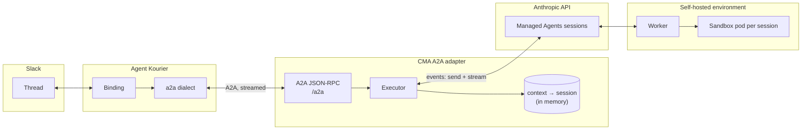
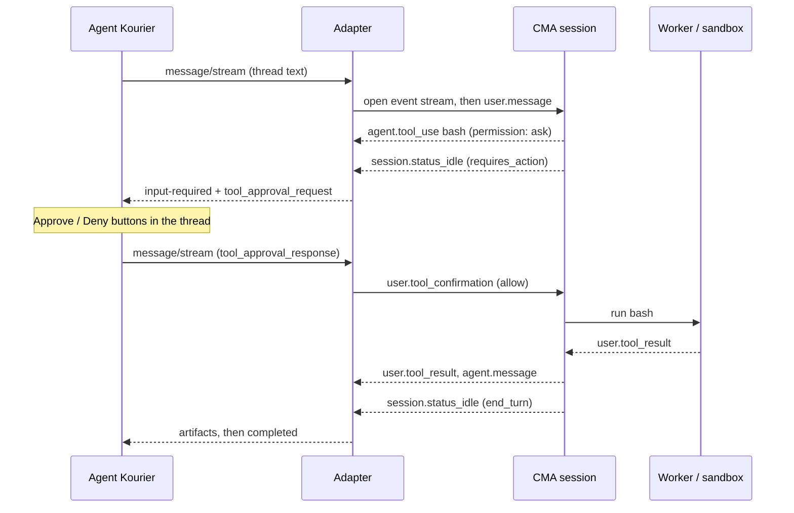

# Claude Managed Agents over A2A

Agent Kourier talks to agents over A2A. Claude Managed Agents (CMA) has no A2A endpoint: it runs the agent loop for
you and exposes sessions through the Anthropic API. This example is an A2A server that sits in front of one CMA agent,
so a Binding drives it with the existing `a2a` dialect and no change to Agent Kourier.

It is experimental. It was tested against a self-hosted CMA environment (the sandbox runs in your own cluster) with a
Haiku agent; it has not been run against a cloud environment.

## How it fits



Agent Kourier owns the chat side: the thread, its session, approvals, timeouts and audit. The adapter only translates. CMA
owns the agent: the model loop, tools and the sandbox the tools run in.

| A2A (what Agent Kourier sees) | CMA (what the adapter does) |
|---|---|
| A context (one Slack thread) | One session, created on the context's first message, with the context ID in its `a2a_context_id` metadata |
| A task | One turn of that session |
| A message's text and data parts | A `user.message` (data parts are sent as JSON text) |
| Artifact text | `agent.message` text |
| ADK `function_call` / `function_response` data parts, which Agent Kourier renders as tool calls | `agent.tool_use` / `agent.mcp_tool_use` and their results; a result is cut to 4000 characters |
| `input-required` with a kagent HITL `tool_approval_request` (Approve/Deny buttons) | A tool call whose permission policy is `always_ask` |
| The HITL `tool_approval_response` | One `user.tool_confirmation` per call; a denial passes its reason on |
| Cancel | `user.interrupt` |
| `completed` | The session idles with `end_turn` |
| `failed` | The session terminates, idles for another reason, the event stream drops, or a sandbox tool gets no result in time (below) |

## A turn with an approval



The adapter opens the session's event stream before it sends anything, because the stream delivers only events that
happen after it opens.

On a self-hosted environment a built-in tool's result comes from the worker as `user.tool_result`, and a tool the agent
may run without asking also idles the session with `requires_action` until that result arrives. The adapter treats
both as waits, not as questions for a person: a pause asks only about the calls that need approval.

## Settings

The adapter is configured through environment variables.

| Variable | Default | What it does |
|---|---|---|
| `CMA_AGENT_ID` | required | The agent to run. Sessions use its latest version. |
| `CMA_ENVIRONMENT_ID` | required | The environment sessions run in. |
| `ANTHROPIC_API_KEY` | | Credentials, read as the Anthropic Go SDK reads them; without it, the active `ant auth login` profile. |
| `LISTEN_ADDR` | `127.0.0.1:8090` | Where the adapter listens. |
| `PUBLIC_URL` | `http://LISTEN_ADDR/a2a` | The endpoint the agent card names; set it to the URL Agent Kourier reaches. |
| `SESSION_IDLE_TTL` | `2160h` | How long a context may go without a turn before its session is archived (checked once a minute, so up to a minute later). `0` never archives. |
| `TOOL_RESULT_TIMEOUT` | `10m` | How long a turn waits, with no session event, for the result of a tool the sandbox runs. `0` waits for ever. |

The adapter serves JSON-RPC at `/a2a`, the agent card at `/a2a/.well-known/agent-card.json`, and `/healthz`. Both
durations must be Go durations of zero or more, or the adapter does not start.

### Session lifecycle

A CMA session holds its sandbox until it is archived. At start the adapter lists the agent's unarchived sessions in the
environment and maps each context back to its session from the `a2a_context_id` metadata, so a restart continues every
thread in its own session. It does not start if that list fails. If two sessions name one context, it keeps the one
active last and archives the others.

`SESSION_IDLE_TTL` archives a context's session once the context has had no turn for that long. Archiving cannot be
undone: the context's next message starts a new session without the old history. Set it to the Binding's
`session.threadTTL` (Agent Kourier's default is `2160h`); past that, Agent Kourier gives the thread a new context and the
old session is never used again. A shorter value archives sessions a thread can still continue.

This setting does not free an idle sandbox's memory; the environment's own idle timeout does that.

### A sandbox that never starts

A self-hosted sandbox that cannot be scheduled (a full node, for instance) sends no event at all: the session just
waits. When a turn waits on a tool the sandbox runs (an allowed call, or one a person approved) and no session event
arrives for `TOOL_RESULT_TIMEOUT`, the adapter interrupts the session and fails the task with status metadata
`code: timeout`. Agent Kourier shows its fixed timeout notice in the thread; the adapter's own message names the sandbox
and the timeout. A tool that runs silently for longer than the timeout is cut off the same way, so set it above your
slowest command.

The wait covers built-in tools only: MCP tools do not run in the sandbox, and a model that is thinking is not waiting
on one.

### Keeping the stream open

Agent Kourier cuts a stream that has been silent for 5 minutes and reconnects to the task. The adapter sends a `working` update after every 60 seconds
without a session event, so a slow turn is not cut off.

## Run it with Slack on kind

`kind/` holds what the end-to-end test used: Agent Kourier in a kind cluster, the adapter on the Docker host.

1. Create a CMA agent with bash set to `always_ask` (so approvals show up) and a self-hosted environment whose worker
   runs in your cluster.
2. Create a Slack app from `kind/slack-app-manifest.yaml`, install it, create an app-level token with
   `connections:write`, and invite the bot to the test channel.
3. Run the adapter on the host. Kind nodes reach the host as `host.docker.internal`:

   ```sh
   cd examples/cma
   CMA_AGENT_ID=agent_... CMA_ENVIRONMENT_ID=env_... \
   LISTEN_ADDR=0.0.0.0:8090 PUBLIC_URL=http://host.docker.internal:8090/a2a \
   go run ./cmd/adapter
   ```

   `LISTEN_ADDR=0.0.0.0:8090` exposes an endpoint with no caller check to your network; see the limits below.
4. Build and load the image (`make image`, then `kind load docker-image agent-kourier:dev --name <cluster>`), create the `slack` Secret
   (`botToken`, `appToken`) in the `agent-kourier` namespace, replace `C0123456789` in `kind/config/kourier.yaml` with the
   channel's ID, create the `cma-kourier-config` ConfigMap from it (key `kourier.yaml`), and install the chart with
   `kind/values.yaml`.
5. Mention the bot in the channel. Replies in the thread continue the same session.

## Test it

Unit tests use a fake backend and spend nothing:

```sh
cd examples/cma && go test -race ./...
```

`livecheck` is a separate module that drives a running adapter with Agent Kourier's own A2A client and `a2a` dialect, the
code a Binding uses. Its offline test runs against a scripted backend; its live scenarios (`text`, `allowed`, `approve`,
`continuity`, `deny`, `cancel`) need an agent with bash set to `always_ask` and spend model tokens. `ONLY=text,deny`
runs a subset.

```sh
cd examples/cma/livecheck
go test -race ./...
ADAPTER_URL=http://127.0.0.1:8090/a2a go run .
```

No CI workflow builds or tests this example yet.

## Limits

- **No caller check.** The adapter accepts any A2A request and runs it on your agent with your credentials. Bind it
  where only Agent Kourier reaches it (the default is loopback).
- **One instance.** The context-to-session map, the A2A tasks and the record of message IDs are in memory. Two adapters
  would start two sessions for one thread.
- **A restart forgets tasks.** The session map is rebuilt from CMA, but a task paused on an approval is not: an
  Approve or Deny pressed after a restart cannot reach the paused call.
- **Approvals need the buttons.** A plain-text reply cannot approve or deny a tool call; the adapter refuses it and the
  task stays paused.
- **No custom tools.** A pause on a custom tool, or on any call the turn did not see ask for approval, fails the turn.
- **Text only.** Messages carry text and data parts; files and images are refused, and the agent's non-text output
  blocks are not shown.
- **Mixed pauses.** If one pause names both an allowed sandbox call and a call that needs approval, the turn that
  resumes after the approval did not see the allowed call start. If the session idles on that call again, the turn
  fails as an action the adapter cannot answer.
- **Session errors are logged only.** A `session.error` event is written to the adapter's log; the turn goes on until
  the session idles or terminates.
